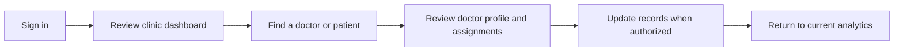
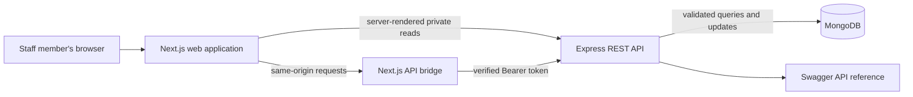

<div align="center">

# 🩺 Doctor Tracker · Frontend

### A calmer workspace for the people coordinating care

**Find doctors. Keep patient records connected. See the bigger picture.**

<br />


**Companion project:** Doctor Tracker REST API · Express 5 · MongoDB · maintained in a separate repository

</div>

---

> [!NOTE]
> **In plain English:** this is the web interface for a clinic operations tracker. Authorized staff can browse doctors and patients, keep assignments up to date, and review operational trends. It is a coordination tool—not an electronic medical record or a substitute for clinical judgment.

## 🧭 At a glance

| 👥 Who uses it                              | ✨ What they can do                                                       | 🔐 Who can change records                                |
| ------------------------------------------- | ------------------------------------------------------------------------- | -------------------------------------------------------- |
| Clinic administrators and read-only viewers | Review dashboards, search and filter directories, inspect doctor profiles | Admins can create or edit records; viewers are read-only |

### The day-to-day workflow



### What is in the workspace

| 🟦 Dashboard                                                            | 🟩 Doctors                                                                     | 🟨 Patients                                                                               | 🟪 Settings                                                      |
| ----------------------------------------------------------------------- | ------------------------------------------------------------------------------ | ----------------------------------------------------------------------------------------- | ---------------------------------------------------------------- |
| Five headline indicators and visual trends, with selectable date ranges | Search, filters, sorting, pagination, doctor profiles, and patient assignments | Search, filters, pagination, patient editing, doctor reassignment, and confirmed deletion | Browser-local appearance and default dashboard range preferences |

**Responsive by design:** the desktop sidebar becomes a mobile navigation drawer; wide data tables become compact cards where appropriate. Light and dark appearance are supported.

## 🏗️ How the pieces work together



- The browser talks to the web app. The Next.js bridge forwards API requests server-to-server.
- A signed session is stored in an **HttpOnly cookie**; frontend JavaScript does not read the JWT.
- Express is the final authority for identity, roles, validation, and data changes.
- TanStack Query manages server data; URL-backed filters make useful views bookmarkable and shareable.
- The settings page currently stores personal preferences in this browser only; it does not change shared clinic settings.

## 🚀 Run locally

### Prerequisites

- Node.js `24.x` and npm
- The companion backend API running at `http://localhost:4000` (see its repository README for setup)
- A backend development database configured and seeded if you want realistic demo records

### Start the frontend

```bash
npm ci
```

Create `.env.local` from the safe template:

```powershell
Copy-Item .env.example .env.local
```

```bash
cp .env.example .env.local
```

Set `API_URL` to the backend API base URL. Configure the same `JWT_SECRET`, `JWT_ISSUER`, and `JWT_AUDIENCE` values in both projects. Use a strong secret locally, never commit it, and do not paste credentials into an issue or README.

```bash
npm run dev
```

Open **<http://localhost:3000>**. Sign-in and live records require the backend to be available.

| Command                | What it does                            |
| ---------------------- | --------------------------------------- |
| `npm run dev`          | Start Next.js in development mode       |
| `npm run lint`         | Check JavaScript and JSX with ESLint    |
| `npm run format:check` | Check formatting with Prettier          |
| `npm run build`        | Create the optimized production build   |
| `npm start`            | Serve a previously built production app |

## 🧩 Main routes and source map

| Route                        | Purpose                                                                  | Access           |
| ---------------------------- | ------------------------------------------------------------------------ | ---------------- |
| `/`                          | Public landing-page component exists; see the current routing note below | Public by design |
| `/login`                     | Sign in to the workspace                                                 | Public           |
| `/dashboard`                 | Analytics overview                                                       | Signed-in users  |
| `/doctors` · `/doctors/[id]` | Doctor directory and profile                                             | Signed-in users  |
| `/patients`                  | Patient directory and record actions                                     | Signed-in users  |
| `/settings`                  | Personal appearance and dashboard defaults                               | Signed-in users  |

```text
src/
├── app/                 Routes, layouts, server-rendered pages, and API bridge
├── components/          Shared navigation, tables, feedback, providers, and UI primitives
├── features/
│   ├── dashboard/       KPI cards, charts, range controls, and loading states
│   ├── doctors/         Directory, profiles, and doctor-related interactions
│   ├── patients/        Directory, filtering, and record editing
│   └── settings/        Browser-local user preferences
├── hooks/               Small reusable browser and date helpers
└── lib/                 API clients, authentication, validation, and shared utilities
```

## 🧠 Two important design choices

### 1. A server-side bridge for sessions and API calls

The browser uses the frontend's own origin; Next.js forwards requests to Express. This keeps API credentials and JWT handling on the server and avoids exposing the session token to browser scripts. Express still validates every protected request and enforces administrator/viewer permissions.

### 2. Match state to its job

| State                                        | Tool                  | Benefit                                                     |
| -------------------------------------------- | --------------------- | ----------------------------------------------------------- |
| Server data                                  | TanStack Query        | Request deduplication, caching, and mutation feedback       |
| Search, filters, pagination, dashboard range | URL state (`nuqs`)    | Refreshable, bookmarkable views and browser history         |
| Form input                                   | React Hook Form + Zod | Consistent client-side validation and useful error messages |

## ✅ Quality checks

Run these before sharing a change or preparing a release:

```bash
npm run lint
npm run format:check
npm run build
```

For a complete manual review, test both roles; create, edit, reassign, and delete only disposable demo records; exercise filters and dashboard ranges; and check keyboard navigation and narrow mobile widths. The frontend build alone does not verify a live backend connection.

## 🛡️ Privacy and safe use

- Use synthetic or approved test data during development; do not place real patient data in screenshots, public repositories, or demo environments.
- Keep `.env.local` private. Rotate any secret that has been disclosed outside its intended secret store.
- The API is the source of truth for access control. Hiding a button in the interface is not a security boundary.
- Configure HTTPS, trusted proxy headers, backups, and environment secrets before production use.

## 🗺️ Current notes

- **Public landing route:** `src/app/page.js` contains a public-facing landing page, but `next.config.mjs` currently redirects `/` to `/dashboard`. Remove or change that redirect when the marketing page should be the public entry point.
- **Settings scope:** preferences are local to one browser. Clinic-wide settings require backend storage and authorization work.
- **Deployment evidence:** no live URL or committed UI screenshots are claimed by this README. Add them after a deployment and visual review are completed.
- **Data meaning:** dashboard counts and records reflect the configured API database; demo data is synthetic and exists for local presentation/testing only.

## 🔗 Project links

- Backend API README: in the separate `doctor-tracker-backend` repository
- [Frontend implementation runbook](RUNBOOK.md)

<div align="center">

**Built for clearer coordination—and with careful attention to privacy. 💙**

</div>
