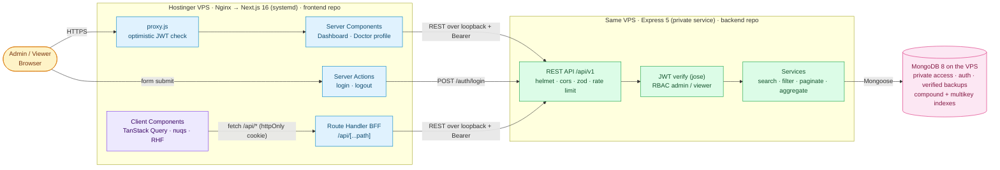
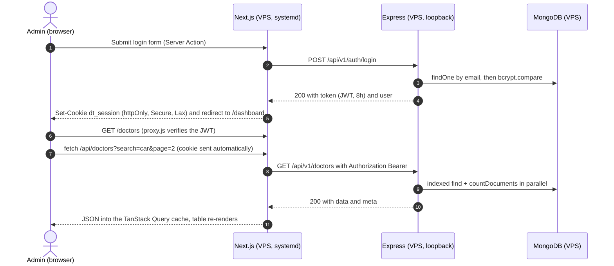
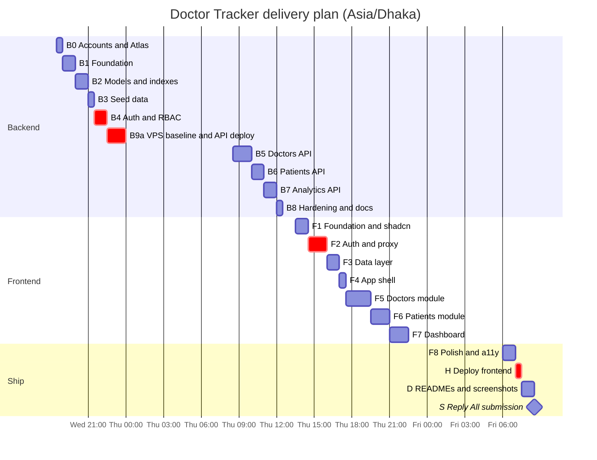
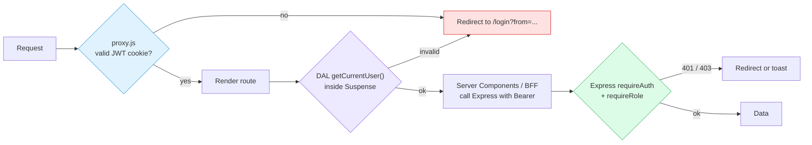

<div align="center">

# 🩺 Doctor Tracker — Implementation Runbook

### 📘 Part 1 of 2 · Frontend (Next.js 16) · Master plan · Hosting · Submission

<br/>


📗 **Companion runbook:** [backend RUNBOOK.md](https://github.com/zakaria-akash/doctor-tracker-backend/blob/main/RUNBOOK.md) — Express 5 · MongoDB 8 · Hostinger VPS. The live deployment (since 22 Oct 2026) is documented in the [VPS deployment and migration record](VPS_DEPLOYMENT_AND_MIGRATION_PLAN.md).

| 🎯 [Mission](#mission) | 🏗️ [Architecture](#architecture) | 🗓️ [Plan](#plan) | 🛠️ [Build F1→F8](#f1) | 🚀 [Deploy](#deploy) | 📝 [README](#readme) | 📮 [Submit](#submit) | 🎤 [Interview](#interview) |
| :---: | :---: | :---: | :---: | :---: | :---: | :---: | :---: |

</div>

---

> [!TIP]
> **How to use this file.** Read it on GitHub or in VS Code (<kbd>Ctrl</kbd>+<kbd>Shift</kbd>+<kbd>V</kbd>). Install the **Markdown Preview Mermaid Support** extension so the diagrams render. Each phase ends with a ✅ **Definition of Done** checklist — tick the boxes as you go.

> [!IMPORTANT]
> This repo runs **Next.js 16.4.2** with `cacheComponents` and `partialPrefetching` switched on. Several APIs differ from older Next.js: `middleware` is now **`proxy`**, `error.js` receives **`retry`**, `cookies()` / `params` / `searchParams` are **async**, and any request-time read must sit inside **`<Suspense>`**. Every snippet below was checked against the bundled docs in `node_modules/next/dist/docs/` and against the exact package versions installed here.

---

## 📑 Table of contents

| # | Section | # | Section |
| --- | --- | --- | --- |
| 0 | [🎯 Mission briefing](#mission) | 9 | [🟥 F6 · Patients module](#f6) |
| 1 | [🏗️ Architecture at a glance](#architecture) | 10 | [📊 F7 · Dashboard & data visualization](#f7) |
| 2 | [🗓️ 48-hour delivery plan](#plan) | 11 | [✨ F8 · UX polish, accessibility & performance](#f8) |
| 3 | [🧰 F0 · Workstation, accounts & current state](#f0) | 12 | [🚀 H · Deploy to the Hostinger VPS + end-to-end check](#deploy) |
| 4 | [🟦 F1 · Project foundation](#f1) | 13 | [📝 D · README & visual evidence](#readme) |
| 5 | [🟩 F2 · Authentication & route protection](#f2) | 14 | [📮 S · Submission (Reply All)](#submit) |
| 6 | [🟨 F3 · Data layer: BFF + TanStack Query + URL state](#f3) | 15 | [🎤 Interview readiness](#interview) |
| 7 | [🟧 F4 · App shell & navigation](#f4) | 16 | [🧯 Troubleshooting](#troubleshooting) |
| 8 | [🟪 F5 · Doctors module](#f5) | 17 | [📚 Reference](#reference) |

---

<a id="mission"></a>

## 🎯 0. Mission briefing

### 0.1 What we are building

> **Doctor Tracker** is a secure admin portal where authenticated staff manage **doctors** and the **patients** assigned to them. They can search, filter and paginate both lists, add and remove patients per doctor, and read a live **analytics dashboard** (totals, patients per doctor, admissions over time, condition mix). The project is graded mainly on the **frontend**: UI/UX quality, performance, data visualization and state management. The backend still has to be clean, indexed and secure.

### 0.2 Three things hidden in the brief

> [!WARNING]
> **1 — The stack was updated.** The PDF's hidden text layer still says *"full-stack inside Next.js"*, but the **visible, updated** spec says:
> **Frontend = Next.js (separate client app)** and **Backend = Node.js + Express (separate standalone server)**, talking over **REST**.
> The email confirms it: it asks for **two repos** and **two live URLs**.

> [!WARNING]
> **2 — The README is graded.** It needs five specific sections (Description · Setup Guide **with `.env.example`** · System Architecture · **2** Technical Decisions · **Desktop + Mobile screenshots**). The current `.gitignore` ignores `.env*`, so `.env.example` would silently never be committed. [F1.1](#f1) fixes that.

> [!WARNING]
> **3 — Hard deadline: 48 hours after the email arrived.** Write your exact cut-off here 👉 `__________`. Submit with **Reply All on the same email thread** — never start a new thread.

> [!IMPORTANT]
> **Hosting (implemented 22 Oct 2026):** Doctor Tracker runs on the existing Hostinger KVM 4 VPS under two new `nip.io` names, with separate systemd services, Nginx + HTTPS, and an isolated MongoDB database migrated from Atlas. The [VPS deployment and migration record](VPS_DEPLOYMENT_AND_MIGRATION_PLAN.md) supersedes this runbook's original fresh-server deployment assumptions.

### 0.3 Deliverables

| 📦 Deliverable | Value (fill in) |
| --- | --- |
| 🟦 Frontend GitHub repo | `https://github.com/zakaria-akash/doctor-tracker` |
| 🟩 Backend GitHub repo | `https://github.com/zakaria-akash/doctor-tracker-backend` |
| 🌐 Live frontend URL | `https://doctor-tracker.58def4e4.nip.io` (Hostinger KVM 4 VPS) |
| 🔌 Live backend API URL | `https://doctor-tracker-api.58def4e4.nip.io/api/v1` (+ `/api/docs`) |
| 🔑 Demo credentials | Admin `admin@doctortracker.test` / `Admin@12345` · Viewer `viewer@doctortracker.test` / `Viewer@12345` |

### 0.4 Requirements traceability matrix

Every line of the brief, mapped to how it's met and where. Use it as the final QA checklist before submitting.

| # | Requirement (PDF / email) | How we satisfy it | Where | Priority |
| --- | --- | --- | --- | --- |
| 2.1 | Only authenticated users can access the portal | `proxy.js` redirect → DAL `getCurrentUser()` → Express `requireAuth` on every data route | [F2](#f2) · backend B4 |  |
| 2.1 | Secure login | bcrypt hashes · JWT (HS256, 8 h, `iss`/`aud`) · `httpOnly` + `Secure` + `SameSite=Lax` cookie · login rate limit | [F2](#f2) · B4 |  |
| 2.1 | Proper **authorization** | RBAC: `admin` (full) vs `viewer` (read-only). API enforces `requireRole('admin')`; the UI hides actions | [F2.8](#f2) · B4 |  |
| 2.2 | Create doctor (name, specialization, hospital, phone, email) | Dialog form (React Hook Form + Zod) → `POST /doctors`; duplicate email → field error | [F5.3](#f5) |  |
| 2.2 | View / search / filter (date + others) / paginate doctors | Table + mobile cards · debounced search · registered-date range · specialization · hospital · sort · server pagination | [F5.2](#f5) |  |
| 2.2 | View a doctor's patients · add patient · delete patient | `/doctors/[id]` profile + patients panel · add dialog (doctor pre-selected) · optimistic delete | [F5.4–F5.5](#f5) |  |
| 2.3 | Dedicated patients page: list, edit, delete | `/patients` · edit side sheet (incl. reassigning the doctor) · confirm + optimistic delete | [F6](#f6) |  |
| 2.3 | Patients: pagination, search, filters (date, condition, others) | Admission-date range · condition · status · gender · doctor · age range | [F6.1](#f6) |  |
| 3 | Dashboard: totals, patients per doctor, date stats, charts | KPI cards · admissions area chart · top-doctors bar · condition donut · specialization bar · status breakdown · range presets | [F7](#f7) |  |
| 3 | Clean aggregation · optimized queries · meaningful insights | One `/analytics/overview` call · parallel index-backed aggregations · 60 s cache · trend vs previous period | [F7](#f7) · B7 |  |
| 4 | Modern UI · spacing & hierarchy · responsive · smooth navigation | shadcn/ui (Radix, *nova*) · brand tokens · sidebar shell · skeletons · toasts · empty states · dark mode | [F1](#f1) · [F4](#f4) · [F8](#f8) |  |
| 4 | Clear navigation: Dashboard · Doctors · Patients | Collapsible sidebar · mobile off-canvas menu · breadcrumbs · active states | [F4](#f4) |  |
| 5 | Indexed search/filter/pagination · efficient queries | ESR compound indexes + multikey search-token index · `lean()` + projection · parallel count · `explain()` proof | backend B2/B5/B8 |  |
| 5 | Avoid unnecessary re-renders | React Compiler · URL state · debounced search · `keepPreviousData` · small client islands | [F1.3](#f1) · [F3](#f3) |  |
| 5 | Clean folders · reusable components · validation & errors | Feature folders · shared `DataTable`/`FilterBar`/… · Zod on both sides · typed error envelope · error boundaries | [F1.7](#f1) · [F5.1](#f5) |  |
| 6 | Next.js frontend + Express backend + MongoDB + REST | Two repos · `/api/v1` resources · proper verbs and status codes | both runbooks |  |
| 6 | State management & data-fetching strategy | TanStack Query (server state) · nuqs (URL state) · RSC for the dashboard | [F3](#f3) |  |
| 7 | README with the 5 mandatory sections | Same section names, same order as the PDF, in both repos | [D](#readme) |  |
| ✉️ | Backend on Render/Vercel/**own VPS** · frontend hosted · 4 links · Reply All · runs locally in the interview | Both apps + MongoDB live on the Hostinger KVM 4 VPS (Nginx · systemd · HTTPS) · email template · interview checklist | [H](#deploy) · [S](#submit) · [🎤](#interview) |  |

### 0.5 How the evaluation criteria map to this plan

| Criterion | Where we score points |
| --- | --- |
| 🧱 Code structure & cleanliness | Feature folders, thin route files, reusable UI kit, ESLint + Prettier, consistent API envelope |
| ⚡ Query optimization | Index design (ESR), search tokens, `explain()` screenshots in the backend README |
| 🎨 UX/UI quality | Design tokens, hierarchy, skeletons, empty/error states, mobile cards, dark mode, micro-interactions |
| 📊 Data visualization | 5 purposeful charts with consistent colours, tooltips, legends, captions and empty states |
| 🚀 Performance | React Compiler, Cache Components shell, debounced fetching, prefetching, lazy charts, cached aggregations |
| 🔐 Authentication | Three layers (proxy → DAL → API), RBAC, httpOnly cookie, rate limiting |
| ✅ Next.js & MongoDB best practices | Server/Client split, Suspense streaming, BFF pattern, indexes, validation, lean reads |
| 📈 Scalability | Stateless API, documented upgrade paths (keyset pagination, Atlas Search, Redis, pre-aggregation) |

---

<a id="architecture"></a>

## 🏗️ 1. Architecture at a glance

### 1.1 System diagram



#### In plain words

1. 🔐 The browser **never talks to Express directly**. It only calls its own origin (`/api/*`), and Next.js forwards the call to Express with `Authorization: Bearer <JWT>`.
2. 🍪 The JWT lives in a **first-party `httpOnly` cookie** on `doctor-tracker.58def4e4.nip.io`, so JavaScript can't read it and no cross-origin cookie rules come into play.
3. 🖥️ **Server Components** (dashboard, doctor profile) and the BFF reach Express over a **private service binding** on the same VPS: no public network hop, and the API service port is never exposed directly.
4. ⚛️ **Client Components** (the interactive tables) use **TanStack Query** through the BFF for caching, smooth pagination and optimistic deletes.

### 1.2 Auth + data request flow



### 1.3 State-management map

| Kind of state | Lives in | Tool | Why |
| --- | --- | --- | --- |
| 🌐 Server state (doctors, patients) | Browser cache, keyed by query | **TanStack Query 5** | Caching, dedupe, cancellation, `keepPreviousData`, invalidation, optimistic updates |
| 🔗 URL state (search, filters, page, sort, open dialog) | The address bar | **nuqs 2** | Shareable links, back/forward, survives refresh, safe with React `<Activity>` |
| 📝 Form state | The form | **React Hook Form 7 + Zod 4** | Uncontrolled inputs (cheap re-renders), schema validation, server-error mapping |
| 🔑 Session | `httpOnly` cookie + DAL | `cookies()`, `jose`, `'use cache: private'` | Secure, readable on the server, prefetchable per session |
| 📊 Dashboard data | RSC payload | Server Component + `<Suspense>` | Read-only aggregates don't need a client cache |
| 🎛️ Ephemeral UI (menus, toggles) | Component | `useState` | Local and short-lived |
| 🌗 Theme | `<html class>` + localStorage | `next-themes` | No flash, follows the system setting |

> [!NOTE]
> **No Redux/Zustand.** Once server state lives in TanStack Query and filters live in the URL, there is no global client state left to manage. That reasoning becomes **Technical Decision #2** in the README.

### 1.4 Route map

| Route | Rendering | Data source | Protection |
| --- | --- | --- | --- |
| `/login` | Static shell + client form | Server Action → Express | Public (authenticated users are redirected away) |
| `/` | Redirect → `/dashboard` | — | — |
| `/dashboard` | Static shell + streamed RSC (`?range=`) | `serverFetch('analytics/overview')` | proxy + DAL |
| `/doctors` | Static shell + client island | TanStack Query → BFF | proxy + DAL + API |
| `/doctors/[id]` | Streamed RSC header + client patients panel | `serverFetch` + TanStack Query | proxy + DAL + API |
| `/patients` | Static shell + client island | TanStack Query → BFF | proxy + DAL + API |
| `/api/[...path]` | Route Handler (BFF) | Express | Cookie → Bearer (401 if missing) |
| `/api/health` | Route Handler | Express `/health` | Public (uptime monitoring) |

---

<a id="plan"></a>

## 🗓️ 2. 48-hour delivery plan

> [!NOTE]
> The timeline assumes you start on **Wed 21 Oct, evening (Asia/Dhaka)** with a cut-off on **Fri 23 Oct, morning**. Shift the blocks if your email arrived at a different time. **Build backend-first** — the frontend is far faster to build against real data.



| Block | Phases | Repo | Budget |
| --- | --- | --- | --- |
| 🌙 **Wed evening** | B0 → B4 + VPS baseline, MongoDB and a first API deploy | backend | ~6 h |
| ☀️ **Thu morning** | B5 → B8 (finish the API, redeploy) | backend | ~4 h |
| 🌇 **Thu afternoon → night** | F1 → F7 | frontend | ~9 h |
| 🌅 **Fri morning** | F8 polish · VPS frontend deploy · Atlas → VPS data migration · READMEs · screenshots · submit | both | ~3.5 h |

### 2.1 Priorities (MoSCoW)

| Priority | Scope |
| --- | --- |
|  | Everything in the [traceability matrix](#mission) · both deployments · READMEs with screenshots |
|  | Viewer role demo · dark mode · optimistic deletes · Swagger at `/api/docs` · seed of ~1,500 patients · React Compiler · nightly DB backups · uptime monitor |
|  | API tests (Vitest + Supertest) · edit/delete doctor · CSV export · `⌘K` quick search · Playwright smoke test |
|  | Refresh-token rotation · Atlas Search · Redis cache · keyset pagination (document these as *future work*) |

> [!CAUTION]
> **Running late? Cut in this order:** COULD items → age-range filter → dark-mode polish → status chart → Swagger. **Never cut:** auth, the three list features (search/filter/paginate), the dashboard charts, the deployments, or the README screenshots.

---

<a id="f0"></a>

## 🧰 3. Phase F0 — Workstation, accounts & current state

### 3.1 ✅ Already done for you (21 Oct)

| Item | State |
| --- | --- |
| Frontend packages | ✅ Installed. Next/React untouched at `16.4.2` / `19.3.0`. `npm run lint` and `npm run build` pass. |
| Backend folder | ✅ `git init -b main`, `package.json` (ESM, Node 24 scripts), `.gitignore`, all packages installed |
| shadcn/ui compatibility | ✅ Tested on a scratch copy: `init` + 30 components + **React Compiler** + `next build` all succeed with the Turbopack Tailwind loader |
| npm install-script policy | ✅ `allowScripts` recorded in both `package.json` files (npm 11.17 feature) |

<details>
<summary>📦 <b>Frontend packages and what each is for</b></summary>

| Package | Version | Purpose |
| --- | --- | --- |
| `@tanstack/react-query` (+ `-devtools`) | 5.104 | Server-state cache for the tables |
| `nuqs` | 2.10 | Type-safe URL search-param state |
| `react-hook-form` · `@hookform/resolvers` · `zod` | 7.90 · 5.9 · 4.6 | Forms + schema validation (resolvers **v5**, because v6.0.0 has a broken peer graph) |
| `jose` · `server-only` | 6.2 · 0.0.1 | JWT verification in `proxy.js` / DAL · server-module guard |
| `shadcn` · `radix-ui` · `class-variance-authority` · `cn` · `tw-animate-css` · `lucide-react` | 4.22 · 1.8 · 0.7 · 0.5 · 1.4 · 1.61 | UI kit runtime (versions match what `shadcn init` installs) |
| `recharts` · `date-fns` · `react-day-picker` · `sonner` · `vaul` · `next-themes` | 3.10 · 4.4 · 10.0 · 2.0 · 1.1 · 0.4 | Dependencies of shadcn's chart, calendar, toast, drawer and theme components |
| `babel-plugin-react-compiler` *(dev)* | 1.0 | Automatic memoization |
| `prettier` · `prettier-plugin-tailwindcss` *(dev)* | 3.9 · 0.8 | Formatting + Tailwind class sorting |

</details>

### 3.2 Accounts (do these first, all free)

- [ ] **GitHub** — two public repos: `doctor-tracker-frontend` and `doctor-tracker-backend`
- [ ] **MongoDB Atlas** — free cluster for **development** (backend runbook, phase B0); production data moves to the VPS later
- [ ] **Hostinger KVM 4 VPS** — Ubuntu 24.04 LTS, your SSH key added, IPv4 noted (backend runbook, B9)
- [ ] **Public DNS and HTTPS:** verify that `doctor-tracker.58def4e4.nip.io` and `doctor-tracker-api.58def4e4.nip.io` resolve globally to the VPS and qualify for certificates; no existing website domain is used.

### 3.3 Tooling

- [ ] Node **24.x** (installed: `v24.19.0`) · npm 11.17
- [ ] VS Code extensions: ESLint · Prettier · Tailwind CSS IntelliSense · Markdown Preview Mermaid Support · REST Client (optional)
- [ ] Chrome with React DevTools (for profiling re-renders and capturing screenshots)
- [ ] OpenSSH client (built into Windows 11) and an `ed25519` SSH key for the VPS

> [!CAUTION]
> **Machine-specific gotcha: `npx shadcn …` fails with `EALLOWSCRIPTS` on this PC.**
> A user-level npm configuration can contain `allow-scripts=node-pty`. `npx` passes that to child processes as `npm_config_allow_scripts`, and npm 11.17 forbids that flag inside project installs, so shadcn's internal `npm install` aborts.
> ✅ **Fix (verified):** run the **local** binary directly — `.\node_modules\.bin\shadcn …` (PowerShell) or `./node_modules/.bin/shadcn …` (Git Bash). Don't use `npm run` either, because it injects the same variable.
> Optional permanent fix: `npm config delete allow-scripts --location=user` (only if nothing else relies on it).

---

<a id="f1"></a>

## 🟦 4. Phase F1 — Project foundation

> ⏱️ **60 min** · 🎯 **Outcome:** env files, hardened config, UI kit initialised, brand tokens and the folder skeleton in place.

### Step F1.1 · Fix `.gitignore` (and keep the assignment PDF private)

```diff
 # env files (can opt-in for committing if needed)
 .env*
+!.env.example
+
+# assignment brief — never publish it
+/*.pdf
```

> [!NOTE]
> Decide whether to commit **this runbook**. It contains your submission email and interview notes. To keep it private, add `RUNBOOK.md` to `.gitignore`.

### Step F1.2 · Environment variables

Create **`.env.example`** (committed) and **`.env.local`** (git-ignored) in the repo root — *not* inside `src/`.

```dotenv
# .env.example — Doctor Tracker frontend
# Base URL of the Express API, including the version prefix. Server-only, never NEXT_PUBLIC_.
API_URL=<copy-the-backend-development-base-url-here>

# Must be IDENTICAL to the backend's values. Used by proxy.js / the DAL to verify the session JWT.
JWT_SECRET=replace-with-the-same-48-byte-secret-as-the-backend
JWT_ISSUER=doctor-tracker-api
JWT_AUDIENCE=doctor-tracker-web
```

| Variable | Exposed to the browser? | Notes |
| --- | --- | --- |
| `API_URL` | ❌ No | Dev: copy the API base URL printed by the backend server. VPS: the API's private loopback address, `http://127.0.0.1:4100/api/v1` (see the [deployment record](VPS_DEPLOYMENT_AND_MIGRATION_PLAN.md)). No `NEXT_PUBLIC_` prefix: the browser only calls `/api/*` |
| `JWT_SECRET` | ❌ No | Generate it once (backend runbook, B1) and paste the same value into both apps |
| `JWT_ISSUER` / `JWT_AUDIENCE` | ❌ No | Must match the backend's claims, otherwise verification fails |

### Step F1.3 · `next.config.mjs` — React Compiler, redirect, security headers

<details>
<summary>📄 <b>next.config.mjs</b> (final version)</summary>

```js
/** @type {import('next').NextConfig} */
const nextConfig = {
  cacheComponents: true,
  partialPrefetching: true,
  reactCompiler: true, // auto-memoizes components → no manual useMemo/useCallback
  poweredByHeader: false,

  async redirects() {
    return [{ source: "/", destination: "/dashboard", permanent: false }];
  },

  async headers() {
    return [
      {
        source: "/(.*)",
        headers: [
          { key: "X-Frame-Options", value: "DENY" },
          { key: "X-Content-Type-Options", value: "nosniff" },
          { key: "Referrer-Policy", value: "strict-origin-when-cross-origin" },
          { key: "Permissions-Policy", value: "camera=(), microphone=(), geolocation=()" },
          { key: "X-Accel-Buffering", value: "no" }, // Nginx on the VPS: stream Suspense chunks immediately
        ],
      },
    ];
  },

  turbopack: {
    rules: {
      "*.css": {
        loaders: ["@tailwindcss/turbopack"],
        as: "*.css",
      },
    },
  },
};

export default nextConfig;
```

</details>

> [!TIP]
> Then delete `src/app/page.js`, since `/` now redirects. Keep the `turbopack.rules` block: Tailwind v4 runs through this loader, and **no PostCSS config** is needed (adding one would process CSS twice).

### Step F1.4 · Prettier

`.prettierrc`:

```json
{
  "semi": true,
  "singleQuote": false,
  "printWidth": 100,
  "plugins": ["prettier-plugin-tailwindcss"],
  "tailwindStylesheet": "./src/app/globals.css",
  "tailwindFunctions": ["cn", "cva"]
}
```

```gitignore
# .prettierignore — keep generated shadcn code pristine so future `shadcn add --diff` stays clean
.next
node_modules
src/components/ui
package-lock.json
```

Scripts already exist: `npm run format`, `npm run format:check`, `npm run lint`, `npm run lint:fix`.

### Step F1.5 · Initialise shadcn/ui (verified commands)

```powershell
# PowerShell, from the frontend repository root (use the local binary; see the F0 caution)
.\node_modules\.bin\shadcn init --template next --base radix --preset nova --yes --no-reinstall

.\node_modules\.bin\shadcn add sidebar card input label textarea select dialog alert-dialog sheet drawer `
  dropdown-menu popover calendar badge table skeleton tabs tooltip avatar separator sonner chart field `
  pagination breadcrumb empty spinner toggle-group scroll-area --yes
```

What this produces (seen in the scratch test):

| Output | Detail |
| --- | --- |
| `components.json` | `"style": "radix-nova"`, `"tsx": false` (→ `.jsx` files), `iconLibrary: lucide` |
| `src/lib/utils.js` | `export { cn } from "cn"` (the new `cn` package replaces `clsx` + `tailwind-merge`) |
| `src/components/ui/*.jsx` | 30 components, including `sidebar`, `chart`, `calendar`, `field`, `empty` |
| `src/hooks/use-mobile.js` | `useIsMobile()` (breakpoint 768 px) |
| `src/app/globals.css` | Adds `@import "tw-animate-css"`, `@import "shadcn/tailwind.css"`, `.dark` variant, theme tokens |

> [!NOTE]
> The *radix* base keeps the familiar `asChild` composition API. The CLI default (`--defaults`) would pick **Base UI**, which uses a `render` prop instead, and most examples online assume Radix.

### Step F1.6 · Brand layer, fonts, metadata

**1 — Brand tokens.** Append these *after* the shadcn tokens in `src/app/globals.css`:

<details>
<summary>🎨 <b>globals.css brand layer</b></summary>

```css
/* ── Doctor Tracker brand layer ─────────────────────────────── */
:root {
  --primary: oklch(0.55 0.12 190); /* clinical teal */
  --primary-foreground: oklch(0.985 0 0);
  --ring: oklch(0.55 0.12 190);
  --chart-1: oklch(0.6 0.12 190); /* teal   → admissions   */
  --chart-2: oklch(0.56 0.19 265); /* indigo → doctors      */
  --chart-3: oklch(0.76 0.15 75); /* amber  → observation  */
  --chart-4: oklch(0.63 0.21 18); /* rose   → critical     */
  --chart-5: oklch(0.62 0.17 300); /* violet → misc         */
}

.dark {
  --primary: oklch(0.74 0.12 190);
  --primary-foreground: oklch(0.21 0.03 200);
  --ring: oklch(0.74 0.12 190);
  --chart-1: oklch(0.72 0.12 190);
  --chart-2: oklch(0.68 0.17 265);
  --chart-3: oklch(0.8 0.14 75);
  --chart-4: oklch(0.7 0.19 18);
  --chart-5: oklch(0.72 0.15 300);
}
```

</details>

**2 — Status palette** (one source of truth, `src/lib/constants.js`):

| Status | Badge style | Meaning |
| --- | --- | --- |
| 🟢 `stable` | `bg-emerald-500/10 text-emerald-700 dark:text-emerald-300` | Routine follow-up |
| 🟡 `under_observation` | `bg-amber-500/10 text-amber-700 dark:text-amber-300` | Being monitored |
| 🔴 `critical` | `bg-rose-500/10 text-rose-700 dark:text-rose-300` | Needs attention (drives a KPI card) |
| 🔵 `recovered` | `bg-sky-500/10 text-sky-700 dark:text-sky-300` | Closed |

Keep these lists in `src/lib/constants.js`, mirrored from the backend enums: `SPECIALIZATIONS`, `CONDITIONS`, `STATUSES`, `GENDERS`, `PAGE_SIZES = [10, 20, 50]`.

**3 — Root layout** (font, metadata, providers):

<details>
<summary>📄 <b>src/app/layout.js</b></summary>

```jsx
import { Plus_Jakarta_Sans } from "next/font/google";
import "./globals.css";
import { AppProviders } from "@/components/providers/app-providers";

const fontSans = Plus_Jakarta_Sans({ subsets: ["latin"], variable: "--font-sans", display: "swap" });

export const metadata = {
  title: { default: "Doctor Tracker", template: "%s · Doctor Tracker" },
  description: "Secure admin portal to manage doctors, patients and clinical analytics.",
};

export default function RootLayout({ children }) {
  return (
    <html lang="en" className={fontSans.variable} suppressHydrationWarning>
      <body className="bg-background text-foreground min-h-dvh font-sans antialiased">
        <AppProviders>{children}</AppProviders>
      </body>
    </html>
  );
}
```

</details>

> [!WARNING]
> **Never read `cookies()` in the root layout.** Under Cache Components it would make every route block on the request. Session reads belong inside a `<Suspense>` boundary ([F2.6](#f2)).

### Step F1.7 · Folder structure

```text
src/
├── proxy.js                         # optimistic auth redirect (Next 16 name for middleware)
├── app/
│   ├── layout.js · globals.css · not-found.js · global-error.js
│   ├── (auth)/login/                # page.js · login-form.js · actions.js
│   ├── (app)/                       # protected area, sharing one shell
│   │   ├── layout.js                # SessionScope + SidebarProvider + header
│   │   ├── loading.js · error.js
│   │   ├── dashboard/page.js
│   │   ├── doctors/page.js
│   │   ├── doctors/[id]/page.js
│   │   └── patients/page.js
│   └── api/
│       ├── [...path]/route.js       # BFF → Express (cookie → Bearer)
│       └── health/route.js          # public health check (uptime monitoring)
├── components/
│   ├── ui/                          # shadcn (generated, don't hand-edit)
│   ├── layout/                      # app-sidebar · app-header · page-header · user-menu · theme-toggle
│   ├── data-table/                  # data-table · pagination · search-input · filter-select
│   │                                # date-range-filter · active-filters · table-skeleton
│   ├── feedback/                    # empty-state · error-state · confirm-dialog · responsive-dialog
│   └── providers/                   # app-providers · user-provider
├── features/
│   ├── doctors/                     # api.js · use-doctor-filters.js · columns.js · components/
│   ├── patients/                    # api.js · use-patient-filters.js · columns.js · components/
│   └── dashboard/                   # kpi-cards · charts/* · range-select
├── hooks/                           # use-mobile.js (shadcn) · use-debounced-value.js
└── lib/
    ├── api/                         # client.js (browser) · server.js (RSC/actions) · errors.js · url.js
    ├── auth/                        # constants.js · jwt.js · session.js · dal.js
    ├── constants.js · format.js · utils.js
    └── validations/                 # doctor.js · patient.js · auth.js (Zod schemas)
```

> [!TIP]
> **Rule of thumb:** `features/*` holds domain logic (queries, columns, forms). `components/*` stays domain-agnostic and reusable. That split is exactly what *"clean folder structure / reusable components"* means to a reviewer.

### ✅ Definition of Done — F1

- [ ] `.env.example` is tracked by git (`git status` shows it) · `.env.local` is not
- [ ] `npm run dev` → `/` redirects to `/dashboard` (404 for now is fine)
- [ ] shadcn components exist under `src/components/ui` · `npm run build` passes
- [ ] Brand teal is visible on a test `<Button>` · font is Plus Jakarta Sans
- [ ] `npm run lint` and `npm run format:check` are clean

---

<a id="f2"></a>

## 🟩 5. Phase F2 — Authentication & route protection

> ⏱️ **90 min** · 🎯 **Outcome:** login/logout work end-to-end, every protected route redirects when signed out, and the UI knows the user's role.
> **Prerequisite:** backend B4 is running locally (`POST /api/v1/auth/login` works).



> [!IMPORTANT]
> **Defense in depth = three layers.** ① `proxy.js` (fast, optimistic) → ② DAL check close to the data → ③ the API enforces auth and roles on **every** request. The Next.js docs are explicit that the proxy alone is *not* an authorization solution.

### Step F2.1 · Shared constants + JWT verifier (proxy-safe)

<details>
<summary>📄 <b>src/lib/auth/constants.js</b> · <b>src/lib/auth/jwt.js</b></summary>

```js
// src/lib/auth/constants.js — no "server-only" import: proxy.js needs these too
export const SESSION_COOKIE = "dt_session";
export const PUBLIC_ROUTES = ["/login"];
```

```js
// src/lib/auth/jwt.js — verifies the API-issued token (used by proxy.js and the DAL)
import { jwtVerify } from "jose";

function getSecret() {
  const secret = process.env.JWT_SECRET;
  if (!secret) throw new Error("JWT_SECRET is not set");
  return new TextEncoder().encode(secret);
}

/** @returns {Promise<{id: string, name: string, email: string, role: "admin" | "viewer"} | null>} */
export async function verifySessionToken(token) {
  if (!token) return null;
  try {
    const { payload } = await jwtVerify(token, getSecret(), {
      algorithms: ["HS256"],
      issuer: process.env.JWT_ISSUER ?? "doctor-tracker-api",
      audience: process.env.JWT_AUDIENCE ?? "doctor-tracker-web",
    });
    return { id: payload.sub, name: payload.name, email: payload.email, role: payload.role };
  } catch {
    return null; // expired, tampered or wrong secret
  }
}
```

</details>

> [!WARNING]
> Don't put `import "server-only"` in files that `proxy.js` imports. The proxy isn't bundled with the `react-server` condition, so that guard would throw. Keep cookie helpers (`session.js`) and the DAL server-only, and keep `jwt.js` / `constants.js` neutral.

### Step F2.2 · Session cookie helpers

<details>
<summary>📄 <b>src/lib/auth/session.js</b></summary>

```js
import "server-only";
import { cookies } from "next/headers";
import { SESSION_COOKIE } from "./constants";

export async function getSessionToken() {
  return (await cookies()).get(SESSION_COOKIE)?.value ?? null;
}

export async function setSessionCookie(token, expiresAt) {
  (await cookies()).set(SESSION_COOKIE, token, {
    httpOnly: true, // invisible to JavaScript → XSS can't steal it
    secure: process.env.NODE_ENV === "production",
    sameSite: "lax", // blocks cross-site POST/PATCH/DELETE → CSRF mitigation
    path: "/",
    expires: new Date(expiresAt), // same lifetime as the JWT
  });
}

export async function clearSessionCookie() {
  (await cookies()).delete(SESSION_COOKIE);
}
```

</details>

### Step F2.3 · Server-side REST client (Server Components & Server Actions)

<details>
<summary>📄 <b>src/lib/api/url.js</b> · <b>src/lib/api/errors.js</b> · <b>src/lib/api/server.js</b></summary>

```js
// src/lib/api/url.js
export function apiBase() {
  const url = process.env.API_URL;
  if (!url) throw new Error("API_URL is not set");
  return url.endsWith("/") ? url : `${url}/`;
}
```

```js
// src/lib/api/errors.js — shared by server and browser code
export class ApiError extends Error {
  constructor(message, status, payload) {
    super(message);
    this.name = "ApiError";
    this.status = status;
    this.code = payload?.code;
    this.fieldErrors = payload?.details?.fieldErrors ?? {};
  }
}
```

```js
// src/lib/api/server.js
import "server-only";
import { notFound, redirect } from "next/navigation";
import { getSessionToken } from "@/lib/auth/session";
import { ApiError } from "./errors";
import { apiBase } from "./url";

export async function serverFetch(path, { searchParams, method = "GET", body, allow404 = false } = {}) {
  const url = new URL(path.replace(/^\//, ""), apiBase());
  for (const [key, value] of Object.entries(searchParams ?? {})) {
    if (value !== undefined && value !== null && value !== "") url.searchParams.set(key, String(value));
  }

  const token = await getSessionToken();
  const res = await fetch(url, {
    method,
    headers: {
      Accept: "application/json",
      ...(body && { "Content-Type": "application/json" }),
      ...(token && { Authorization: `Bearer ${token}` }),
    },
    body: body ? JSON.stringify(body) : undefined,
    signal: AbortSignal.timeout(15_000), // same server over loopback → fail fast
  });

  if (res.status === 401) redirect("/login?expired=1");
  if (res.status === 404 && allow404) notFound();

  const json = await res.json().catch(() => null);
  if (!res.ok) throw new ApiError(json?.error?.message ?? `Request failed (${res.status})`, res.status, json?.error);
  return json;
}
```

</details>

### Step F2.4 · Login: Server Action + page + health route

<details>
<summary>📄 <b>src/app/(auth)/login/actions.js</b></summary>

```js
"use server";

import { redirect } from "next/navigation";
import { z } from "zod";
import { setSessionCookie } from "@/lib/auth/session";
import { apiBase } from "@/lib/api/url";

const LoginSchema = z.object({
  // Zod 4: trim BEFORE the email check — z.email().trim() rejects " a@b.com " (verified)
  email: z.string().trim().toLowerCase().pipe(z.email("Enter a valid email address")),
  password: z.string().min(1, "Password is required"),
  from: z.string().optional(),
});

export async function loginAction(_prevState, formData) {
  const parsed = LoginSchema.safeParse(Object.fromEntries(formData));
  if (!parsed.success) {
    return { ok: false, fieldErrors: z.flattenError(parsed.error).fieldErrors };
  }

  const { email, password, from } = parsed.data;
  let res;
  try {
    res = await fetch(new URL("auth/login", apiBase()), {
      method: "POST",
      headers: { "Content-Type": "application/json" },
      body: JSON.stringify({ email, password }),
      signal: AbortSignal.timeout(15_000),
    });
  } catch {
    return { ok: false, message: "The authentication service is unreachable. Please try again." };
  }

  const json = await res.json().catch(() => null);
  if (!res.ok) return { ok: false, message: json?.error?.message ?? "Login failed" };

  await setSessionCookie(json.data.token, json.data.expiresAt);
  redirect(safeRedirect(from)); // outside try/catch — redirect() works by throwing
}

/** Only same-origin relative paths → no open redirects */
function safeRedirect(path) {
  return typeof path === "string" && path.startsWith("/") && !path.startsWith("//") ? path : "/dashboard";
}
```

</details>

<details>
<summary>📄 <b>src/app/api/health/route.js</b> — public health check for uptime monitoring</summary>

```js
import { connection } from "next/server";
import { apiBase } from "@/lib/api/url";

export async function GET() {
  await connection(); // always run at request time
  try {
    const res = await fetch(new URL("health", apiBase()), { signal: AbortSignal.timeout(5_000) });
    return Response.json(
      { frontend: "ok", api: res.ok ? "ok" : "degraded" },
      { status: res.ok ? 200 : 503, headers: { "Cache-Control": "no-store" } },
    );
  } catch {
    return Response.json({ frontend: "ok", api: "down" }, { status: 503, headers: { "Cache-Control": "no-store" } });
  }
}
```

</details>

**Login page design** (`page.js` is a Server Component, `login-form.js` is a client component):

| Area | Content |
| --- | --- |
| 🎨 Left panel (`lg:` only) | Gradient `from-teal-600 via-cyan-700 to-indigo-800`, logo (lucide `Stethoscope`), headline *"Care, organised."*, three value bullets, subtle grid pattern |
| 📝 Right panel | Card with email + password (show/hide toggle), submit with `<Spinner/>` while pending, inline error `Alert` |
| 🧪 Demo helpers | Two ghost buttons, **"Use admin demo"** and **"Use viewer demo"**, which fill in the credentials (reviewers love this) |
| ⏳ Pending state | Submit button shows `<Spinner/>` and is disabled · inputs keep their values after an error |

<details>
<summary>📄 <b>Key parts of login-form.js</b></summary>

```jsx
"use client";

import { useActionState, useState } from "react";
import { useSearchParams } from "next/navigation";
import { loginAction } from "./actions";

export function LoginForm() {
  const searchParams = useSearchParams(); // ⚠️ page must wrap <LoginForm/> in <Suspense>
  const [state, formAction, pending] = useActionState(loginAction, { ok: true });
  const [email, setEmail] = useState("");
  const [password, setPassword] = useState("");

  return (
    <form action={formAction} className="space-y-4">
      <input type="hidden" name="from" value={searchParams.get("from") ?? ""} />
      {/* <Field> + <Input name="email" value={email} onChange=…> + <FieldError> … */}
      {/* <Field> + <Input name="password" type="password" …> */}
      {/* {state.message && <Alert variant="destructive">{state.message}</Alert>} */}
      {/* <Button type="submit" disabled={pending}>{pending && <Spinner />} Sign in</Button> */}
    </form>
  );
}
```

Inputs are controlled, so they keep their values after a failed attempt; the Server Action re-validates everything on the server.

</details>

### Step F2.5 · `src/proxy.js` — optimistic route protection

<details>
<summary>📄 <b>src/proxy.js</b></summary>

```js
import { NextResponse } from "next/server";
import { PUBLIC_ROUTES, SESSION_COOKIE } from "@/lib/auth/constants";
import { verifySessionToken } from "@/lib/auth/jwt";

export async function proxy(request) {
  const { pathname, search, searchParams } = request.nextUrl;
  const isPublic = PUBLIC_ROUTES.some((route) => pathname === route || pathname.startsWith(`${route}/`));

  // Session rejected by the API (e.g. user deleted) → drop the cookie and avoid a redirect loop
  if (isPublic && searchParams.has("expired")) {
    const res = NextResponse.next();
    res.cookies.delete(SESSION_COOKIE);
    return res;
  }

  const user = await verifySessionToken(request.cookies.get(SESSION_COOKIE)?.value);

  if (!user && !isPublic) {
    const loginUrl = new URL("/login", request.url);
    loginUrl.searchParams.set("from", `${pathname}${search}`);
    const res = NextResponse.redirect(loginUrl);
    res.cookies.delete(SESSION_COOKIE); // clear stale/expired tokens
    return res;
  }

  if (user && isPublic) return NextResponse.redirect(new URL("/dashboard", request.url));
  return NextResponse.next();
}

export const config = {
  // Skip the BFF (it authenticates itself), Next internals and static files
  matcher: ["/((?!api|_next/static|_next/image|favicon.ico|.*\\.(?:svg|png|jpg|jpeg|webp|ico)$).*)"],
};
```

</details>

> [!NOTE]
> The proxy runs on the **Node.js runtime** (Next 16 default, not configurable), so `jose` works. HS256 verification takes microseconds and needs no database call, which is exactly the "optimistic check" the docs recommend.

### Step F2.6 · DAL + sharing the user with Client Components

<details>
<summary>📄 <b>src/lib/auth/dal.js</b> · <b>user-provider.js</b> · <b>(app)/layout.js</b></summary>

```js
// src/lib/auth/dal.js
import "server-only";
import { redirect } from "next/navigation";
import { getSessionToken } from "./session";
import { verifySessionToken } from "./jwt";

export async function getCurrentUser() {
  "use cache: private"; // reads cookies(), cached per session in the browser → prefetchable shell
  const user = await verifySessionToken(await getSessionToken());
  if (!user) redirect("/login");
  return user; // narrow DTO: id, name, email, role — never the raw token
}
```

```jsx
// src/components/providers/user-provider.js  (pattern from the Next 16 auth + Cache Components guide)
"use client";
import { createContext, use } from "react";

const UserContext = createContext(null);

export function UserProvider({ userPromise, children }) {
  return <UserContext value={userPromise}>{children}</UserContext>;
}

export function useUser() {
  const userPromise = use(UserContext);
  if (!userPromise) throw new Error("useUser must be used inside <UserProvider>");
  return use(userPromise); // suspends → callers must sit inside <Suspense>
}
```

```jsx
// src/app/(app)/layout.js
import { Suspense } from "react";
import { getCurrentUser } from "@/lib/auth/dal";
import { UserProvider } from "@/components/providers/user-provider";
import { SidebarInset, SidebarProvider } from "@/components/ui/sidebar";
import { AppSidebar } from "@/components/layout/app-sidebar";
import { AppHeader } from "@/components/layout/app-header";
import { AppShellSkeleton } from "@/components/layout/app-shell-skeleton";

export default function AppLayout({ children }) {
  return (
    <Suspense fallback={<AppShellSkeleton />}>
      <SessionScope>
        <SidebarProvider>
          <AppSidebar />
          <SidebarInset>
            <AppHeader />
            <main className="mx-auto w-full max-w-7xl flex-1 p-4 md:p-6 lg:p-8">{children}</main>
          </SidebarInset>
        </SidebarProvider>
      </SessionScope>
    </Suspense>
  );
}

// Create the promise INSIDE the boundary; don't await it, so the shell renders immediately
function SessionScope({ children }) {
  return <UserProvider userPromise={getCurrentUser()}>{children}</UserProvider>;
}
```

</details>

> [!WARNING]
> **Don't `await` the session at the top of a layout.** It would hold back `{children}` for every route below it. Also don't read the shadcn sidebar's state cookie in this layout, for the same reason (use the default open state).

### Step F2.7 · Logout

```js
// src/app/(auth)/login/actions.js (append)
export async function logoutAction() {
  await clearSessionCookie(); // import from "@/lib/auth/session"
}
```

```jsx
// in the user menu (client component)
const queryClient = useQueryClient();
async function handleLogout() {
  await logoutAction();
  queryClient.clear();
  window.location.replace("/login"); // full reload clears <Activity>-preserved route state
}
```

> [!IMPORTANT]
> With `cacheComponents`, Next.js keeps recently visited routes mounted inside React `<Activity>`. A plain `router.push("/login")` would leave the previous user's UI state alive. The docs recommend a **full reload** on logout, so use `window.location.replace`.

### Step F2.8 · Role-aware UI

```jsx
const user = useUser();
const canEdit = user.role === "admin";
// hide "Add doctor", row edit/delete actions, etc. when !canEdit
// show a small "Read-only" badge in the header for viewers
```

The UI only *hides* actions. The API returns `403 FORBIDDEN` for viewers no matter what (backend B4), and the client turns that into a toast: *"You don't have permission to do that."*

### ✅ Definition of Done — F2

- [ ] Signed out: visiting `/doctors` → `/login?from=%2Fdoctors`. After login you land back on `/doctors`
- [ ] Signed in: visiting `/login` → `/dashboard`
- [ ] DevTools → Application → Cookies: `dt_session` is **HttpOnly** and **SameSite=Lax** (and **Secure** in production)
- [ ] Wrong password → friendly inline error · 11 bad attempts → "Too many login attempts"
- [ ] Logout → back button doesn't reveal any data
- [ ] Viewer account → no create/edit/delete buttons anywhere
- [ ] `npm run build` passes (no "uncached data outside `<Suspense>`" errors)

---

<a id="f3"></a>

## 🟨 6. Phase F3 — Data layer: BFF + TanStack Query + URL state

> ⏱️ **60 min** · 🎯 **Outcome:** one typed path from a table to Express — browser → `/api/*` → Express — with caching, cancellation, debouncing and consistent error handling.

### 6.1 API contract (summary)

Full contract, payloads and error codes: **backend runbook → §2 API contract**. All list endpoints return `{ success, data, meta: { page, limit, total, totalPages, hasNextPage, hasPrevPage } }`.

| Method | Endpoint (BFF path → Express `/api/v1/...`) | Used by | Role |
| --- | --- | --- | --- |
| `GET` | `doctors?search&specialization&hospital&from&to&sort&page&limit` | Doctors table | any |
| `POST` | `doctors` | Add-doctor dialog | admin |
| `GET` | `doctors/:id` | Doctor profile (RSC via `serverFetch`) | any |
| `GET` | `doctors/:id/patients?search&page&limit…` | Doctor's patients panel | any |
| `POST` | `doctors/:id/patients` | Add patient under doctor | admin |
| `DELETE` | `doctors/:id/patients/:patientId` | Remove patient from doctor | admin |
| `GET` | `patients?search&condition&status&gender&doctor&from&to&minAge&maxAge&sort&page&limit` | Patients table | any |
| `PATCH` | `patients/:id` | Edit-patient sheet | admin |
| `DELETE` | `patients/:id` | Delete patient | admin |
| `GET` | `analytics/overview?range=7d\|30d\|90d\|12m\|all` | Dashboard (RSC) | any |
| `GET` | `meta/options` | Filter dropdowns + doctor select | any |

### Step F3.1 · The BFF Route Handler

<details>
<summary>📄 <b>src/app/api/[...path]/route.js</b></summary>

```js
import { NextResponse } from "next/server";
import { getSessionToken } from "@/lib/auth/session";
import { apiBase } from "@/lib/api/url";

// Allow-list: the browser may reach these resources only (auth goes through Server Actions)
const ALLOWED = /^(doctors|patients|analytics|meta)(\/|$)/;

const fail = (status, code, message) =>
  NextResponse.json({ success: false, error: { code, message } }, { status, headers: { "Cache-Control": "no-store" } });

async function forward(request, { params }) {
  const { path } = await params; // Next 16: params is a Promise
  const subPath = path.join("/");
  if (!ALLOWED.test(subPath)) return fail(404, "NOT_FOUND", "Unknown API route");

  // CSRF defense-in-depth on top of SameSite=Lax
  if (request.method !== "GET") {
    const origin = request.headers.get("origin");
    if (origin && origin !== request.nextUrl.origin) return fail(403, "FORBIDDEN", "Invalid origin");
  }

  const token = await getSessionToken();
  if (!token) return fail(401, "UNAUTHORIZED", "Not signed in");

  const body = ["GET", "HEAD"].includes(request.method) ? undefined : await request.text();
  let upstream;
  try {
    upstream = await fetch(new URL(`${subPath}${request.nextUrl.search}`, apiBase()), {
      method: request.method,
      headers: {
        Accept: "application/json",
        Authorization: `Bearer ${token}`,
        ...(body && { "Content-Type": "application/json" }),
      },
      body: body || undefined,
      signal: AbortSignal.timeout(15_000),
    });
  } catch {
    return fail(503, "UPSTREAM_UNAVAILABLE", "The API is unreachable. Please retry in a moment.");
  }

  if (upstream.status === 204) return new Response(null, { status: 204 });
  return new Response(await upstream.text(), {
    status: upstream.status,
    headers: {
      "Content-Type": upstream.headers.get("content-type") ?? "application/json",
      "Cache-Control": "no-store",
    },
  });
}

export { forward as GET, forward as POST, forward as PATCH, forward as DELETE };
```

</details>

### Step F3.2 · Browser HTTP client

<details>
<summary>📄 <b>src/lib/api/client.js</b></summary>

```js
import { ApiError } from "./errors";

/** Thin fetch wrapper for Client Components → same-origin BFF. */
export async function http(path, { method = "GET", params, body, signal } = {}) {
  const query = new URLSearchParams(
    Object.entries(params ?? {}).filter(([, v]) => v !== undefined && v !== null && v !== ""),
  ).toString();

  const res = await fetch(`/api/${path}${query ? `?${query}` : ""}`, {
    method,
    signal,
    headers: body ? { "Content-Type": "application/json" } : undefined,
    body: body ? JSON.stringify(body) : undefined,
  });

  if (res.status === 401) {
    window.location.assign(`/login?expired=1&from=${encodeURIComponent(location.pathname + location.search)}`);
    throw new ApiError("Your session has expired", 401);
  }
  if (res.status === 204) return null;

  const json = await res.json().catch(() => ({}));
  if (!res.ok) throw new ApiError(json?.error?.message ?? "Something went wrong", res.status, json?.error);
  return json;
}
```

</details>

### Step F3.3 · Providers

<details>
<summary>📄 <b>src/components/providers/app-providers.js</b></summary>

```jsx
"use client";

import { isServer, QueryClient, QueryClientProvider } from "@tanstack/react-query";
import { ReactQueryDevtools } from "@tanstack/react-query-devtools";
import { NuqsAdapter } from "nuqs/adapters/next/app";
import { ThemeProvider } from "next-themes";
import { TooltipProvider } from "@/components/ui/tooltip";
import { Toaster } from "@/components/ui/sonner";

function makeQueryClient() {
  return new QueryClient({
    defaultOptions: {
      queries: {
        staleTime: 30_000,
        refetchOnWindowFocus: false,
        retry: (count, error) => error?.status >= 500 && count < 2, // never retry 4xx
      },
    },
  });
}

let browserQueryClient;
function getQueryClient() {
  if (isServer) return makeQueryClient(); // isolate server renders
  browserQueryClient ??= makeQueryClient(); // reuse one cache in the browser
  return browserQueryClient;
}

export function AppProviders({ children }) {
  return (
    <ThemeProvider attribute="class" defaultTheme="system" enableSystem disableTransitionOnChange>
      <QueryClientProvider client={getQueryClient()}>
        <NuqsAdapter>
          <TooltipProvider delayDuration={200}>
            {children}
            <Toaster richColors closeButton position="top-right" />
          </TooltipProvider>
        </NuqsAdapter>
        <ReactQueryDevtools initialIsOpen={false} buttonPosition="bottom-left" />
      </QueryClientProvider>
    </ThemeProvider>
  );
}
```

</details>

### Step F3.4 · Query keys, query options and mutations (one file per feature)

<details>
<summary>📄 <b>src/features/doctors/api.js</b></summary>

```js
import { keepPreviousData, queryOptions, useMutation, useQueryClient } from "@tanstack/react-query";
import { toast } from "sonner";
import { http } from "@/lib/api/client";

export const doctorKeys = {
  all: ["doctors"],
  lists: () => [...doctorKeys.all, "list"],
  list: (params) => [...doctorKeys.lists(), params],
  patients: (doctorId, params) => [...doctorKeys.all, doctorId, "patients", params],
};

export const doctorsQuery = (params) =>
  queryOptions({
    queryKey: doctorKeys.list(params),
    queryFn: ({ signal }) => http("doctors", { params, signal }), // stale requests are cancelled
    placeholderData: keepPreviousData, // old page stays visible while the next loads → no flicker
  });

export function useCreateDoctor() {
  const queryClient = useQueryClient();
  return useMutation({
    mutationFn: (values) => http("doctors", { method: "POST", body: values }),
    onSuccess: ({ data }) => {
      toast.success(`${data.name} was added`);
      queryClient.invalidateQueries({ queryKey: doctorKeys.lists() });
      queryClient.invalidateQueries({ queryKey: ["meta"] }); // doctor dropdowns
    },
  });
}
```

</details>

<details>
<summary>📄 <b>Optimistic delete</b> (patients — the same pattern works for "remove from doctor")</summary>

```js
export function useDeletePatient() {
  const queryClient = useQueryClient();
  return useMutation({
    mutationFn: (id) => http(`patients/${id}`, { method: "DELETE" }),
    onMutate: async (id) => {
      await queryClient.cancelQueries({ queryKey: patientKeys.lists() });
      const snapshots = queryClient.getQueriesData({ queryKey: patientKeys.lists() });
      queryClient.setQueriesData({ queryKey: patientKeys.lists() }, (old) =>
        old ? { ...old, data: old.data.filter((p) => p.id !== id), meta: { ...old.meta, total: old.meta.total - 1 } } : old,
      );
      return { snapshots };
    },
    onError: (error, _id, context) => {
      context?.snapshots.forEach(([key, data]) => queryClient.setQueryData(key, data)); // roll back
      toast.error(error.message);
    },
    onSuccess: () => toast.success("Patient deleted"),
    onSettled: () => {
      queryClient.invalidateQueries({ queryKey: patientKeys.all });
      queryClient.invalidateQueries({ queryKey: doctorKeys.all }); // patient counts changed
    },
  });
}
```

</details>

### Step F3.5 · URL state with nuqs + debounced search

> [!IMPORTANT]
> **Verified nuqs behaviour:** the hook's *state* updates **instantly** on every keystroke; `limitUrlUpdates: debounce()` only delays the **URL write**. For client-side fetching, debounce the value that goes into the **query key** separately, as the nuqs docs recommend.

<details>
<summary>📄 <b>use-debounced-value.js</b> · <b>use-doctor-filters.js</b> · search input</summary>

```js
// src/hooks/use-debounced-value.js
"use client";
import { useEffect, useState } from "react";

export function useDebouncedValue(value, delay = 350) {
  const [debounced, setDebounced] = useState(value);
  useEffect(() => {
    const id = setTimeout(() => setDebounced(value), delay);
    return () => clearTimeout(id);
  }, [value, delay]);
  return debounced;
}
```

```js
// src/features/doctors/use-doctor-filters.js
"use client";
import { parseAsInteger, parseAsIsoDate, parseAsString, parseAsStringLiteral, useQueryStates } from "nuqs";
import { endOfDay, startOfDay } from "date-fns";
import { useDebouncedValue } from "@/hooks/use-debounced-value";

export const DOCTOR_SORTS = ["newest", "oldest", "name_asc", "name_desc"];

export const doctorFilterParsers = {
  page: parseAsInteger.withDefault(1),
  limit: parseAsInteger.withDefault(10),
  search: parseAsString.withDefault(""),
  specialization: parseAsString.withDefault(""),
  hospital: parseAsString.withDefault(""),
  from: parseAsIsoDate, // ?from=2026-01-01
  to: parseAsIsoDate,
  sort: parseAsStringLiteral(DOCTOR_SORTS).withDefault("newest"),
};

export function useDoctorFilters() {
  const [filters, setFilters] = useQueryStates(doctorFilterParsers);
  const search = useDebouncedValue(filters.search, 350);

  const apiParams = {
    ...filters,
    search,
    from: filters.from ? startOfDay(filters.from).toISOString() : undefined, // user's local day
    to: filters.to ? endOfDay(filters.to).toISOString() : undefined,
  };
  return { filters, setFilters, apiParams };
}
```

```jsx
// inside <SearchInput> — instant UI, debounced URL, debounced fetch
import { debounce } from "nuqs";

<Input
  value={filters.search}
  onChange={(e) =>
    setFilters(
      { search: e.target.value, page: 1 }, // always reset to page 1 when filters change
      { limitUrlUpdates: e.target.value === "" ? undefined : debounce(350) },
    )
  }
  placeholder="Search name, specialization, hospital, email…"
  aria-label="Search doctors"
/>
```

</details>

### Step F3.6 · Mapping API validation errors onto form fields

```js
// src/lib/api/form-errors.js
export function applyServerErrors(error, setError) {
  const entries = Object.entries(error?.fieldErrors ?? {});
  entries.forEach(([field, messages]) => setError(field, { type: "server", message: messages[0] }));
  return entries.length > 0; // true → handled inline, otherwise show a toast
}
```

`409 CONFLICT` (duplicate email) and `422 VALIDATION_ERROR` both carry `details.fieldErrors`, so one helper covers both.

> [!CAUTION]
> **Cache Components rules for client data:**
>
> 1. Every component that calls `useQueryStates` / `useSearchParams` / `useQuery` during the first render must sit **inside `<Suspense>`**. Otherwise the build fails, or you get a *current-time prerender* error, because TanStack Query reads `Date.now()`.
> 2. Don't use TanStack's stock `dehydrate()` for server prefetching with Cache Components (it reads the time during prerender). We don't need SSR prefetch for the tables; skeletons plus fast indexed queries are enough.

### ✅ Definition of Done — F3

- [ ] Network tab shows `GET /api/doctors?...` (same-origin) — **no** request to `doctor-tracker-api.58def4e4.nip.io` from the browser
- [ ] Typing quickly in search triggers **one** request ~350 ms after the last keystroke · URL updates too
- [ ] Changing page keeps the previous rows visible (dimmed) until the next page arrives
- [ ] Deleting the session cookie and clicking "Next page" sends you to `/login?expired=1`
- [ ] TanStack Devtools shows keys like `["doctors","list",{...}]`

---

<a id="f4"></a>

## 🟧 7. Phase F4 — App shell & navigation

> ⏱️ **30 min** · 🎯 **Outcome:** a polished, responsive shell — collapsible sidebar, mobile drawer, header with breadcrumb, theme toggle and user menu.

```text
┌────────────┬──────────────────────────────────────────────────────┐
│ 🩺 Doctor  │ ☰  Dashboard / Doctors / Dr. Rahman     🌗  [AR ▾]    │  ← AppHeader
│   Tracker  ├──────────────────────────────────────────────────────┤
│            │  Doctors                              [ + Add doctor ]│  ← PageHeader
│ ▣ Dashboard│  Manage doctors, specializations and patients.        │
│ 👨‍⚕️ Doctors │  ┌──────────────────────────────────────────────────┐ │
│ 🧑‍🤝‍🧑 Patients│  │ 🔍 Search…  [Specialization ▾] [Hospital ▾] [📅]  │ │
│            │  ├──────────────────────────────────────────────────┤ │
│            │  │  table rows / mobile cards                       │ │
│ ─────────  │  └──────────────────────────────────────────────────┘ │
│ [AR] Admin │  Showing 1–10 of 48         ‹ 1 2 3 … 5 ›   [10 ▾]     │
└────────────┴──────────────────────────────────────────────────────┘
```

| Piece | Implementation notes |
| --- | --- |
| `AppSidebar` | shadcn `Sidebar collapsible="icon"` · header with logo · `SidebarMenuButton isActive={pathname.startsWith(href)}` · tooltips when collapsed · `SidebarRail` · user card in the footer |
| Nav items | Dashboard (`LayoutDashboard`), Doctors (`Stethoscope`), Patients (`Users`) — lucide icons |
| Mobile | The sidebar becomes an off-canvas `Sheet` automatically (`useIsMobile`) · `SidebarTrigger` in the header |
| `AppHeader` | Sticky, `backdrop-blur` · trigger · `Breadcrumb` derived from the pathname · theme toggle · user menu (name, role badge, logout) |
| `PageHeader` | `h1` + description + action slot → consistent hierarchy on every page |
| Pending nav feedback | `useLinkStatus()` (Next 16) inside nav links → small spinner while a route loads |
| `loading.js` | Page-shaped skeleton for the `(app)` group |
| `error.js` | Client component using **`retry`** (Next 16.3+), not the old `reset` |
| `not-found.js` | Friendly 404 with a "Back to dashboard" button |

<details>
<summary>📄 <b>src/app/(app)/error.js</b></summary>

```jsx
"use client";

import { Button } from "@/components/ui/button";

export default function Error({ error, retry }) {
  return (
    <div className="mx-auto flex max-w-md flex-col items-center gap-4 py-24 text-center">
      <h2 className="text-xl font-semibold">Something went wrong</h2>
      <p className="text-muted-foreground text-sm">{error.digest ? `Reference: ${error.digest}` : error.message}</p>
      <Button onClick={() => retry()}>Try again</Button>
    </div>
  );
}
```

</details>

> [!WARNING]
> **`<Activity>` gotcha:** routes stay mounted (hidden) when you navigate away, so a dialog left open will still be open when you come back. Drive dialogs and sheets from the **URL** (`?new=1`, `?edit=<id>` via nuqs). Navigating away clears the param, and as a bonus the dialogs become deep-linkable.

### ✅ Definition of Done — F4

- [ ] Sidebar collapses to icons on desktop and becomes a drawer below 768 px
- [ ] Active item is highlighted · breadcrumb is correct on `/doctors/[id]`
- [ ] Theme toggle switches instantly with no flash on reload
- [ ] Throwing inside a page shows `error.js`, and **Try again** recovers

---

<a id="f5"></a>

## 🟪 8. Phase F5 — Doctors module

> ⏱️ **120 min** · 🎯 **Outcome:** list + search + filters + pagination, create-doctor form, doctor profile with patients (add/remove).

### Step F5.1 · Reusable building blocks (build once, use on both list pages)

| Component | Props (sketch) | Notes |
| --- | --- | --- |
| `DataTable` | `columns, data, isPending, isFetching, emptyState, renderMobileCard, getRowHref` | `<table>` on `md+`, cards below · `aria-busy` · dim rows while `isFetching` |
| `DataTablePagination` | `meta, onPageChange, onLimitChange` | "Showing 21–30 of 312" · page numbers with ellipsis · size select `10/20/50` · prefetches page + 1 |
| `SearchInput` | `value, onChange, placeholder` | Lucide `Search` icon · clear (×) button · `aria-label` |
| `FilterSelect` | `label, value, options, onChange` | shadcn `Select` + "All" option |
| `DateRangeFilter` | `from, to, onChange` | `Popover` + `Calendar mode="range"` + presets: Today · 7d · 30d · This month · This year |
| `ActiveFilters` | `filters, onClear(key), onClearAll` | Removable chips under the bar · "Reset all" |
| `TableSkeleton` | `columns, rows` | Same geometry as the real rows → no layout shift |
| `EmptyState` | `icon, title, description, action` | shadcn `Empty` · "Clear filters" CTA when filters are active |
| `ConfirmDialog` | `title, description, confirmLabel, onConfirm, pending` | shadcn `AlertDialog`, destructive style |
| `ResponsiveDialog` | `open, onOpenChange, title, children` | `Dialog` on desktop, `Drawer` (vaul) on mobile via `useIsMobile()` |
| `StatusBadge` / `ConditionBadge` | `value` | Colours from `src/lib/constants.js` |

> [!TIP]
> Define `columns` at **module scope** (not inside the component) and let the React Compiler handle the rest. That alone eliminates most accidental table re-renders.

<details>
<summary>📄 <b>Prefetch the next page</b> (instant "Next" clicks)</summary>

```js
const queryClient = useQueryClient();
useEffect(() => {
  if (data?.meta?.hasNextPage) {
    queryClient.prefetchQuery(doctorsQuery({ ...apiParams, page: apiParams.page + 1 }));
  }
}, [data?.meta?.hasNextPage, apiParams, queryClient]);
```

</details>

### Step F5.2 · Doctors list page

```jsx
// src/app/(app)/doctors/page.js — Server Component: static header + client island in Suspense
import { Suspense } from "react";
import { PageHeader } from "@/components/layout/page-header";
import { TableSkeleton } from "@/components/data-table/table-skeleton";
import { DoctorsView } from "@/features/doctors/components/doctors-view";

export const metadata = { title: "Doctors" };

export default function DoctorsPage() {
  return (
    <>
      <PageHeader title="Doctors" description="Manage doctors, their specializations and patients." />
      <Suspense fallback={<TableSkeleton columns={6} rows={10} />}>
        <DoctorsView />
      </Suspense>
    </>
  );
}
```

| Column | Content | Mobile card |
| --- | --- | --- |
| Doctor | Avatar initials (tinted by specialization) + name + email | ✅ title |
| Specialization | Badge | ✅ |
| Hospital | Text, truncated with tooltip | ✅ |
| Phone | `tel:` link | — |
| Patients | Count pill (from the API's `patientCount`) | ✅ |
| Joined | `format(createdAt, "dd MMM yyyy")` | — |
| Actions | "View" → `/doctors/[id]` | tap the card |

**Filters:** search · specialization · hospital (from `meta/options`) · registered date range · sort (Newest, Oldest, Name A→Z, Name Z→A). Every filter change resets `page` to 1.

### Step F5.3 · Create-doctor dialog

| Field | Validation (mirrors the backend Zod schema) |
| --- | --- |
| Name | 2–80 chars · placeholder "Dr. Ayesha Rahman" |
| Specialization | Select from `SPECIALIZATIONS` |
| Hospital | 2–120 chars · `datalist` suggestions from existing hospitals |
| Phone | `^\+?[0-9\s()-]{7,20}$` |
| Email | `z.string().trim().toLowerCase().pipe(z.email())` · duplicate → server 409 mapped onto the field |

UX: open via `?new=1` · autofocus the first field · submit shows `<Spinner/>` and is disabled while pending · on success: toast, close, reset the form and invalidate the lists · `Esc`/Cancel closes · viewers never see the button.

### Step F5.4 · Doctor profile — `/doctors/[id]`

```jsx
// src/app/(app)/doctors/[id]/page.js — params is a Promise → resolve it INSIDE Suspense (Next 16 pattern)
import { Suspense } from "react";
import { notFound } from "next/navigation";
import { serverFetch } from "@/lib/api/server";

export default function DoctorPage({ params }) {
  return (
    <Suspense fallback={<DoctorProfileSkeleton />}>
      {params.then(({ id }) => (
        <DoctorProfile id={id} />
      ))}
    </Suspense>
  );
}

async function DoctorProfile({ id }) {
  if (!/^[a-f\d]{24}$/i.test(id)) notFound();
  const { data: doctor } = await serverFetch(`doctors/${id}`, { allow404: true });
  return (
    <>
      <DoctorProfileCard doctor={doctor} /> {/* avatar, specialization, hospital, contact, patient count, joined */}
      <DoctorPatientsPanel doctorId={id} doctorName={doctor.name} /> {/* client: TanStack + nuqs */}
    </>
  );
}
```

### Step F5.5 · Add / remove patients under a doctor

- **Add patient:** button in the panel header → `ResponsiveDialog` with the patient form; the doctor is **pre-selected and locked** → `POST doctors/:id/patients` → invalidate `doctorKeys.patients(id)`, `patientKeys.all` and the doctor counts.
- **Remove patient:** row action → `ConfirmDialog` (*"Remove Rahim Uddin from Dr. Rahman's patient list? This deletes the patient record."*) → optimistic removal → `DELETE doctors/:id/patients/:patientId`.

> [!NOTE]
> Every patient belongs to exactly one doctor, so "delete from the doctor's list" deletes the record. Moving a patient to another doctor happens in **Edit patient** on the Patients page. Write this down in the README's assumptions.

### ✅ Definition of Done — F5

- [ ] Search "card" finds cardiologists · "square" finds a hospital · partial words work
- [ ] Each filter, the date range and sort all work together and appear in the URL · refresh keeps them
- [ ] Pagination meta is correct · page size change resets to page 1
- [ ] Duplicate email shows an inline field error (409)
- [ ] Profile shows the correct patient count · add + remove update both lists and counts
- [ ] Mobile: cards, filters in a drawer, dialogs as bottom sheets

---

<a id="f6"></a>

## 🟥 9. Phase F6 — Patients module

> ⏱️ **90 min** · 🎯 **Outcome:** a dedicated patients page with rich filters, an edit sheet and safe deletes.

### Step F6.1 · List + filters

| Filter | Control | API param |
| --- | --- | --- |
| Search | `SearchInput` (name, condition, phone, email) | `search` |
| Condition | `FilterSelect` from `CONDITIONS` | `condition` |
| Status | Toggle group (All · Stable · Observation · Critical · Recovered) | `status` |
| Gender | `FilterSelect` | `gender` |
| Doctor | Searchable select from `meta/options.doctors` | `doctor` |
| Admission date | `DateRangeFilter` | `from`, `to` (ISO, local day bounds) |
| Age | Two small number inputs (min/max) | `minAge`, `maxAge` |
| Sort | Newest · Oldest · Name · Age | `sort` |

| Column | Content |
| --- | --- |
| Patient | Initials avatar + name + phone/email |
| Age / Gender | `34 · F` |
| Condition | `ConditionBadge` |
| Status | `StatusBadge` (coloured dot + label, not colour alone) |
| Doctor | Link to `/doctors/[id]` |
| Admitted | Relative + absolute date in a tooltip |
| Actions | Edit · Delete (admin only) |

### Step F6.2 · Edit patient (side sheet)

- Opened via `?edit=<patientId>` → `Sheet side="right"` on desktop, `Drawer` on mobile.
- Prefill from the row in the cache (instant) and fall back to `GET patients/:id` on deep links.
- Fields: name, age, gender, phone, email, condition, status, admission date (date picker), notes (≤ 500 chars, with counter), **doctor** (re-assign).
- `PATCH patients/:id` with **only the changed fields** (`formState.dirtyFields`) → toast → invalidate lists + doctor counts → close.

### Step F6.3 · Delete patient

`ConfirmDialog` → optimistic removal ([F3.4](#f3)) → rollback + toast on error.

### ✅ Definition of Done — F6

- [ ] Each filter works on its own and combined · chips show the active filters
- [ ] Editing a patient's doctor moves them between the two doctors' lists
- [ ] Deep link `/patients?status=critical&edit=<id>` opens the sheet with filters applied
- [ ] Viewer sees no edit/delete · a forced API call returns 403 + a toast

---

<a id="f7"></a>

## 📊 10. Phase F7 — Dashboard & data visualization

> ⏱️ **90 min** · 🎯 **Outcome:** an insight-driven dashboard: KPIs with trends plus five purposeful charts, all from **one** API call.

### 10.1 Layout

```text
┌ KPI ───────────┬ KPI ───────────┬ KPI ───────────┬ KPI ───────────┐
│ 👨‍⚕️ Doctors 48  │ 🧑 Patients 1.5k│ 📈 New 312 ▲12% │ 🚨 Critical 41  │
└────────────────┴────────────────┴────────────────┴────────────────┘
┌ Patient admissions (area, 2/3) ─────────────────┬ By condition (donut)┐
│   ╱╲      ╱╲╱╲                                   │      ◔ Diabetes 22% │
└─────────────────────────────────────────────────┴─────────────────────┘
┌ Top 10 doctors by patients (horizontal bar) ────┬ Doctors by specialization ┐
└─────────────────────────────────────────────────┴───────────────────────────┘
```

### 10.2 Data flow (Server Component + URL range)

```jsx
// src/app/(app)/dashboard/page.js
import { Suspense } from "react";
import { serverFetch } from "@/lib/api/server";
import { PageHeader } from "@/components/layout/page-header";
import { RangeSelect } from "@/features/dashboard/range-select";
import { DashboardSkeleton } from "@/features/dashboard/dashboard-skeleton";
import { KpiCards } from "@/features/dashboard/kpi-cards";
import { DashboardCharts } from "@/features/dashboard/charts";

const RANGES = ["7d", "30d", "90d", "12m", "all"];
export const metadata = { title: "Dashboard" };

export default function DashboardPage({ searchParams }) {
  return (
    <>
      <PageHeader
        title="Dashboard"
        description="Live overview of doctors, patients and admissions."
        actions={
          <Suspense fallback={null}>
            <RangeSelect /> {/* nuqs, shallow: false + startTransition */}
          </Suspense>
        }
      />
      <Suspense fallback={<DashboardSkeleton />}>
        <DashboardContent searchParams={searchParams} />
      </Suspense>
    </>
  );
}

async function DashboardContent({ searchParams }) {
  const { range } = await searchParams;
  const safeRange = RANGES.includes(range) ? range : "12m";
  const { data } = await serverFetch("analytics/overview", { searchParams: { range: safeRange } });
  return (
    <>
      <KpiCards totals={data.totals} />
      <DashboardCharts data={data} /> {/* client component (Recharts) */}
    </>
  );
}
```

`RangeSelect` uses `useQueryState("range", parseAsStringLiteral(RANGES).withDefault("12m").withOptions({ shallow: false, startTransition }))`. `shallow: false` re-renders the Server Component, and the transition keeps the old charts on screen (dimmed) instead of flashing the skeleton.

### 10.3 The charts

| # | Chart | Data | Why it's meaningful |
| --- | --- | --- | --- |
| 1 | 🟦 **KPI cards** | `totals` | Doctors · patients · new patients **with % change vs previous period** · critical now · avg patients/doctor |
| 2 | 📈 **Area chart** — admissions over time | `patientsOverTime` (daily ≤ 31 d, else monthly; gaps filled with 0) | Trend and seasonality at a glance |
| 3 | 📊 **Horizontal bar** — top 10 doctors by patients | `patientsPerDoctor` | "Patients per doctor" requirement · spot overloaded doctors |
| 4 | 🍩 **Donut** — patients by condition | `byCondition` | Case-mix insight · total in the centre label |
| 5 | 🧱 **Bar** — doctors by specialization | `doctorsBySpecialization` | Staffing coverage |
| 6 | 🚦 **Status breakdown** (stacked bar or radial) | `byStatus` | Clinical risk snapshot (uses the status palette) |

<details>
<summary>📄 <b>Area chart with the shadcn chart wrapper</b></summary>

```jsx
"use client";

import { Area, AreaChart, CartesianGrid, XAxis, YAxis } from "recharts";
import { ChartContainer, ChartTooltip, ChartTooltipContent } from "@/components/ui/chart";

const config = { count: { label: "Admissions", color: "var(--chart-1)" } };

export function AdmissionsChart({ data }) {
  return (
    <ChartContainer config={config} className="aspect-auto h-72 w-full">
      <AreaChart data={data} margin={{ left: 4, right: 12 }}>
        <defs>
          <linearGradient id="fillCount" x1="0" y1="0" x2="0" y2="1">
            <stop offset="5%" stopColor="var(--color-count)" stopOpacity={0.35} />
            <stop offset="95%" stopColor="var(--color-count)" stopOpacity={0.02} />
          </linearGradient>
        </defs>
        <CartesianGrid vertical={false} strokeDasharray="3 3" />
        <XAxis dataKey="period" tickLine={false} axisLine={false} tickMargin={8} minTickGap={24} />
        <YAxis width={36} tickLine={false} axisLine={false} allowDecimals={false} />
        <ChartTooltip cursor={false} content={<ChartTooltipContent indicator="line" />} />
        <Area dataKey="count" type="monotone" stroke="var(--color-count)" fill="url(#fillCount)" strokeWidth={2} />
      </AreaChart>
    </ChartContainer>
  );
}
```

</details>

### 10.4 Chart UX rules

- 🎨 One colour per meaning, used everywhere (teal = admissions, rose = critical …) · both themes come from tokens
- 🏷️ Every chart sits in a `Card` with a **title + one-line insight** (*"Admissions up 12% vs previous 30 days"*)
- 🔢 Format numbers with `Intl.NumberFormat` (`1.5K`) · dates with `date-fns` · tooltips always show exact values
- 🫥 Empty data → an empty state inside the card, never a blank axis
- ♿ `role="img"` + `aria-label` summary on each chart container; never rely on colour alone (legends, labels)
- 🐢 Optional: lazy-load the charts bundle with `next/dynamic` from a client wrapper to trim initial JS

### ✅ Definition of Done — F7

- [ ] Switching range updates all widgets without a full-page skeleton flash
- [ ] Numbers match the lists (e.g. critical count = Patients page filtered by `status=critical`)
- [ ] Charts look right in light **and** dark mode and at 375 px width
- [ ] Network: exactly **one** analytics request per range change

---

<a id="f8"></a>

## ✨ 11. Phase F8 — UX polish, accessibility & performance

> ⏱️ **60 min** · 🎯 **Outcome:** the "wow, this feels finished" pass that frontend-focused reviewers look for.

### 11.1 States matrix (every data view must cover all four)

| View | ⏳ Loading | 🫥 Empty | ⚠️ Error | 🔄 Refetching |
| --- | --- | --- | --- | --- |
| Doctors / Patients tables | Row skeletons | `EmptyState` + CTA / "Clear filters" | Inline error + **Retry** (`refetch`) | Rows dimmed + thin top progress bar |
| Doctor profile | Card skeleton | — | `error.js` with `retry()` | — |
| Dashboard | KPI + chart skeletons | Per-chart empty state | `error.js` with `retry()` | Transition-dimmed charts |
| Forms | Disabled submit + spinner | — | Inline field errors + toast | — |

### 11.2 Responsive checklist

| Breakpoint | Behaviour |
| --- | --- |
| `< 640 px` | Card lists · full-width buttons · filters in a drawer with an active-count badge · dialogs as bottom drawers |
| `640–1023 px` | Two-column KPI grid · charts stack · sidebar off-canvas |
| `≥ 1024 px` | Sidebar expanded/collapsible · tables · four-column KPIs · two-column chart grid |

### 11.3 Accessibility checklist

- [ ] Every input has a visible `<Label>` (shadcn `Field`) · errors linked through `aria-invalid` / `aria-describedby`
- [ ] Keyboard: Tab order is logical · `Esc` closes dialogs · focus returns to the trigger · visible focus ring (`--ring`)
- [ ] Status shown as **dot + text**, never colour alone · contrast ≥ 4.5:1 in both themes
- [ ] `aria-live="polite"` region announces "48 doctors found"
- [ ] Animations respect `prefers-reduced-motion`

### 11.4 Performance checklist

- [ ] React Compiler **on** (`reactCompiler: true`) — no manual memoization needed
- [ ] React DevTools Profiler: typing in search re-renders the input + table only, not the sidebar/header
- [ ] Debounced fetching (350 ms) · request cancellation through `signal` · `keepPreviousData` · next-page prefetch
- [ ] Static shell for each page (header/filters skeleton paint instantly) · dynamic parts stream in `<Suspense>`
- [ ] `next/font` self-hosted · no layout shift from skeletons (CLS ≈ 0)
- [ ] Lighthouse (production build, mobile): **Performance ≥ 90 · Accessibility ≥ 95 · Best Practices ≥ 95**

> [!TIP]
> Profile with `npm run build && npm start`, not with `npm run dev`. Dev mode is intentionally slower and double-renders.

---

<a id="deploy"></a>

## 🚀 12. Phase H — Deploy to the Hostinger VPS ✅

> [!NOTE]
> **Deployed and verified on 22 October 2026.** The [VPS deployment and migration record](VPS_DEPLOYMENT_AND_MIGRATION_PLAN.md) documents every step, the measured results, and the rollback procedure. This runbook's earlier PM2, port, and example-domain assumptions for a fresh server never applied to this VPS, which already hosts other websites.

| Public entry point | Live address |
| --- | --- |
| Frontend | [https://doctor-tracker.58def4e4.nip.io](https://doctor-tracker.58def4e4.nip.io) |
| Backend API | [https://doctor-tracker-api.58def4e4.nip.io/api/v1](https://doctor-tracker-api.58def4e4.nip.io/api/v1/health) · [Swagger](https://doctor-tracker-api.58def4e4.nip.io/api/docs) |

**What runs:** Nginx terminates TLS (one Let's Encrypt certificate for both names, HTTP/2) and sends every path on the web host, including `/api/*`, to `next start` on `127.0.0.1:3100` (`doctor-tracker-web.service`). The BFF reaches Express on `127.0.0.1:4100` (`doctor-tracker-api.service`) over loopback, and Express uses its own `doctor_tracker` database on the server's authenticated, loopback-only MongoDB. Both services run as a dedicated unprivileged user under systemd sandboxing and CPU/memory budgets. No existing website, service, database, certificate, or backup job was modified.

### Deployment gates — all passed

1. **Before:** ✅ read-only audit of the server, the snapshot reported by the owner, and a 50-probe baseline of every existing site. DNS resolved through four public resolvers.
2. **Stage:** ✅ a dedicated `doctortracker` user, root-owned release directories, and secrets generated on the server. Locked `npm ci` installs and the 52-second frontend build ran in a CPU- and memory-capped unit.
3. **Migrate:** ✅ a trial restore into a staging database, then a write-frozen final restore into `doctor_tracker`. Counts, indexes, references, and per-collection BSON hashes matched Atlas exactly. The destructive seed never ran.
4. **Cut over:** ✅ only the two Doctor Tracker vhosts were added, each Nginx change passed `nginx -t`, and every reload was graceful. Unknown hosts are still rejected.
5. **Accept:** ✅ external HTTPS checks, 27 loopback API/BFF checks, and 15 real-browser checks (desktop and 390 px mobile). All 50 existing-site probes still matched the baseline, and a backup restore drill succeeded.

### Shipping a new release

Only committed code ships. Create a tarball with `git archive --format=tar.gz -o web.tar.gz HEAD -- . ':(exclude)*.pdf'`, copy it to the VPS, then run `sudo doctor-tracker-release deploy web ~/web.tar.gz`. The tool builds the release as the app user and switches the `current` symlink atomically. It restarts only `doctor-tracker-web`, waits for `/login` to answer, and rolls back automatically on failure. `sudo doctor-tracker-release rollback web` returns to the previous release.

A `nip.io` address encodes the public IP. If the VPS IP ever changes, both hostnames, the certificate, and the API's CORS origin must change together.

---

<a id="readme"></a>

## 📝 13. Phase D — README & visual evidence (graded)

> ⏱️ **60 min** for both repos. Use **the PDF's section names in the PDF's order** so a reviewer can tick them off in seconds.

### 13.1 Frontend README skeleton

````markdown
# 🩺 Doctor Tracker — Frontend

<badges> · **Live:** https://doctor-tracker.58def4e4.nip.io · **API:** https://doctor-tracker-api.58def4e4.nip.io/api/docs

> **Demo:** Admin `admin@doctortracker.test` / `Admin@12345` · Viewer (read-only) `viewer@doctortracker.test` / `Viewer@12345`
> 🖥️ Self-hosted on a Hostinger KVM 4 VPS: Nginx + Let's Encrypt · systemd · MongoDB 8 (authentication, verified backups).

## 1. Description
<one-paragraph elevator pitch: who it's for, what it does, what makes it fast and secure>

## 2. Setup Guide
Prerequisites (Node 24, the backend running in development mode) → clone → `npm ci` → `cp .env.example .env.local` → fill values → `npm run dev` → open the URL printed by the dev server. Table of npm scripts.

## 3. System Architecture
<mermaid diagram from §1.1> + 5 bullets on the data flow (browser → BFF → Express → Atlas, auth layers, caching).

## 4. Technical Decisions
### 4.1 Why a BFF + httpOnly cookie instead of a JWT in localStorage
### 4.2 Why TanStack Query + URL state instead of Redux / Context

## 5. Visual Evidence
| Desktop | Mobile |
| --- | --- |
|  |  |
| … | … |

## Extras
Features · Project structure · Deployment (Hostinger VPS: Nginx, systemd, TLS) · Performance & accessibility · Security · Assumptions · Future improvements · Author
````

### 13.2 Technical Decision drafts (adapt them, keep them honest)

<details>
<summary>🧠 <b>Decision 1 — BFF + httpOnly cookie, not localStorage and not direct browser→API calls</b></summary>

- **Context.** The frontend (`doctor-tracker.58def4e4.nip.io`) and the API (`doctor-tracker-api.58def4e4.nip.io`) are separate apps on different origins. Calling the API straight from the browser would need CORS plus a cookie shared across subdomains, or a token in `localStorage`, which any injected script can read and Server Components can't see (ruling out server-side auth checks). The design also keeps working when the frontend is mirrored on another host such as Vercel, where a cookie set by the API would become a blocked *third-party* cookie.
- **Decision.** Express issues a short-lived JWT. The Next.js server stores it in a first-party `httpOnly; Secure; SameSite=Lax` cookie. The browser calls only same-origin `/api/*` (a Route Handler BFF), which attaches `Authorization: Bearer`. Server Components call Express directly.
- **Consequences.** ✅ XSS can't exfiltrate the token · ✅ no CORS or third-party-cookie problems · ✅ `proxy.js` can gate routes before render · ✅ Express stays a clean, stateless Bearer API that is easy to test with Swagger and curl. ⚠️ One extra hop (over loopback on the VPS, ≈ 1 ms) · ⚠️ the JWT secret is shared with the Next server for local verification (server-only env vars, `iss`/`aud` claims; RS256 with a public key would remove the shared secret).

</details>

<details>
<summary>🧠 <b>Decision 2 — TanStack Query + nuqs instead of Redux Toolkit / Context</b></summary>

- **Context.** Almost all state in this app is either *server state* (doctors, patients) or *URL state* (filters, page, sort). Very little is genuinely global client state.
- **Decision.** TanStack Query owns server state (cache, dedupe, cancellation, `keepPreviousData`, invalidation, optimistic updates). nuqs owns filters/pagination in the URL. React Hook Form owns forms.
- **Alternatives.** Redux Toolkit means hand-written async logic and normalization for data the server already owns (RTK Query would work, but adds a store we don't need). Context re-renders every consumer on any change and has no caching.
- **Consequences.** ✅ Shareable/bookmarkable filtered views · ✅ back/forward just works · ✅ no flicker between pages · ✅ less code. ⚠️ Two cache layers to coordinate (Next router cache for RSC, TanStack for tables), handled by query-key factories and explicit invalidation.

</details>

### 13.3 Screenshot shot list

| # | Desktop (1440 × 900) | Mobile (390 × 844) |
| --- | --- | --- |
| 1 | Login | Login |
| 2 | Dashboard (light) + Dashboard (dark) | Dashboard |
| 3 | Doctors list with active filters | Doctors cards |
| 4 | Doctor profile + patients | Filters drawer |
| 5 | Add-doctor dialog showing validation errors | Navigation drawer open |
| 6 | Patients list filtered by `critical` | Edit-patient bottom sheet |
| 7 | Edit-patient side sheet | — |

**How:** Chrome DevTools → <kbd>Ctrl</kbd>+<kbd>Shift</kbd>+<kbd>M</kbd> → pick a device (or Responsive 1440×900) → ⋮ → **Capture screenshot**. Save to `docs/screenshots/desktop-*.png` / `mobile-*.png`, and compress them (Squoosh or TinyPNG, < 300 KB each). Use realistic seeded data, never empty states, in the hero shots.

---

<a id="submit"></a>

## 📮 14. Phase S — Submission (Reply All on the original email)

### 14.1 Pre-flight checklist

- [ ] Both repos are **public** (or reviewers are invited) · default branch `main` · no `.env` committed (`git log -p | findstr MONGODB_URI` → nothing)
- [ ] Both READMEs have the 5 sections, live links, demo credentials and screenshots
- [x] Live URLs tested in a fresh browser profile · both new systemd services healthy · certificate valid on both `nip.io` names · Doctor Tracker backup and restore drill verified (22 Oct 2026, [deployment record](VPS_DEPLOYMENT_AND_MIGRATION_PLAN.md))
- [ ] Assignment PDF **not** in the repo · no secrets or TODOs left in code · `npm run lint` clean in both repos

### 14.2 Email template

```text
Subject: (keep the original "Re: …" subject; use REPLY ALL on the same thread)

Dear Hiring Team,

Thank you for the opportunity. Please find my Doctor Tracker submission below.

• Live frontend:    https://doctor-tracker.58def4e4.nip.io
• Live backend API: https://doctor-tracker-api.58def4e4.nip.io/api/v1
  (health: /api/v1/health · interactive docs: https://doctor-tracker-api.58def4e4.nip.io/api/docs)
• Frontend repository: https://github.com/zakaria-akash/doctor-tracker
• Backend repository:  https://github.com/zakaria-akash/doctor-tracker-backend

Demo credentials
• Admin (full access):   admin@doctortracker.test / Admin@12345
• Viewer (read-only, demonstrates role-based authorization): viewer@doctortracker.test / Viewer@12345

Hosting: both apps and the MongoDB database are self-hosted on a Hostinger KVM 4 VPS
(Ubuntu 24.04, Nginx + Let's Encrypt, systemd, MongoDB 8 with authentication and verified backups).

Highlights: Next.js 16 (Cache Components, React Compiler), BFF with httpOnly-cookie sessions,
TanStack Query + URL-synced filters, Express 5 + Zod validation, index-backed search with
explain()-verified MongoDB queries, and an analytics dashboard built on aggregation pipelines.

I'm happy to walk through the code and run the project locally during the interview.

Best regards,
<Your Name>
<Phone> · <LinkedIn / Portfolio>
```

---

<a id="interview"></a>

## 🎤 15. Interview readiness

### 15.1 Local run checklist (the email requires this)

- [ ] Fresh clone of both repos into a temp folder → `npm ci` → `.env` from `.env.example` → `npm run dev` (backend first) → it works
- [ ] Laptop charged, Node 24, VS Code, Chrome, both repos open in separate windows
- [ ] Approved VPS SSH access works · you can show the two Doctor Tracker systemd services, their Nginx site files, and the latest verified backup without changing other sites
- [ ] **Offline fallback:** run a development MongoDB container or MongoDB Community Server → set `MONGODB_URI` to the private address provided by that database → `npm run seed` in the disposable development database only → run both apps

### 15.2 Three-minute demo script

1. **Viewer login** → read-only UI → try a forbidden action → 403 toast *(authorization)*
2. **Admin login** → dashboard insights → switch range *(RSC + aggregations)*
3. **Doctors** → search "car", filter by specialization, date range, paginate, share the URL *(URL state)*
4. Open a doctor → **add** a patient → **remove** one (instant, optimistic)
5. **Patients** → filter `critical` → edit → reassign doctor
6. Resize to mobile → navigation drawer, cards, bottom sheets · toggle dark mode
7. Code tour: `proxy.js` → `dal.js` → BFF route → `features/doctors/api.js` → backend indexes + an `explain()` screenshot

### 15.3 Likely questions — crisp answers

| Question | Answer in one breath |
| --- | --- |
| How are routes protected? | Three layers: optimistic JWT check in `proxy.js`, the DAL inside Suspense, and Express `requireAuth`/`requireRole` on every request. |
| Why not localStorage? | XSS-readable and invisible to Server Components. httpOnly first-party cookies avoid both, and Safari's third-party-cookie blocking too. |
| How do you avoid re-renders? | React Compiler auto-memoizes, state is co-located (URL/query cache), input updates are debounced, and client islands are small. |
| How is Mongo optimized? | ESR compound indexes, a multikey search-token index for prefix search, `lean()` + projections, parallel `countDocuments`, cached aggregations — all proven with `explain()`. |
| Scale to millions of patients? | Keyset pagination, Atlas Search, pre-aggregated daily stats via `$merge`, Redis for cache/rate limits, read replicas for analytics. |
| What happens when the token expires? | The API returns 401 → BFF → client redirects to `/login?expired=1`. Next step would be refresh-token rotation. |
| What does Cache Components change? | Static shells prerender instantly. Anything reading cookies/searchParams streams inside `<Suspense>`. `'use cache: private'` makes the session read prefetchable. |
| How is it deployed? | It runs on a Hostinger KVM 4 VPS behind two new Nginx sites with Let's Encrypt TLS. Two sandboxed systemd services listen on loopback, backed by a separately authenticated MongoDB database migrated byte-for-byte from Atlas. Only SSH, HTTP, and HTTPS are public, and the database gets nightly verified backups. Releases are health-checked and roll back automatically, and every other site on the server was verified untouched ([record](VPS_DEPLOYMENT_AND_MIGRATION_PLAN.md)). |

---

<a id="troubleshooting"></a>

## 🧯 16. Troubleshooting & Next 16 gotchas

| Symptom | Cause | Fix |
| --- | --- | --- |
| `EALLOWSCRIPTS` running `npx shadcn …` | User-level `allow-scripts` leaks through npx env vars | Use `.\node_modules\.bin\shadcn …` |
| Build: *uncached data accessed outside `<Suspense>`* / blocking-route insight | `cookies()`, `searchParams` or a fetch read outside a boundary | Move the read into a child wrapped in `<Suspense>`; as a last resort `export const instant = false` |
| *Current-time prerender* error | `useQuery`/`dehydrate()` running during prerender | Keep data views inside `<Suspense>`; don't use stock `dehydrate()` |
| `useSearchParams` / nuqs bailout error | Client URL hook rendered during prerender | Wrap that component in `<Suspense>` |
| Redirect loop `/login` ↔ `/dashboard` | `JWT_SECRET`/`ISSUER`/`AUDIENCE` differ between the apps | Make them identical in both environments |
| Login works in development, fails on the VPS | No HTTPS (the `Secure` cookie is dropped), or the JWT settings in `/etc/doctor-tracker/web.env` and `api.env` differ | Check the certificate and make the JWT values identical, then `sudo systemctl restart doctor-tracker-web` (only that service) |
| `503 UPSTREAM_UNAVAILABLE` | API process down or crashed | `systemctl status doctor-tracker-api` · `journalctl -u doctor-tracker-api` · `curl -s http://127.0.0.1:4100/api/v1/health` on the VPS |
| `502 Bad Gateway` from Nginx | Next.js / Express service unavailable on its loopback port | `systemctl status doctor-tracker-web doctor-tracker-api`; `sudo doctor-tracker-release rollback web` if a new release is at fault. Never restart other sites' services |
| Pages appear all at once instead of streaming | Nginx is buffering responses | Keep `proxy_buffering off` and the `X-Accel-Buffering: no` header ([F1.3](#f1)) |
| Dialog is open again after navigating back | `<Activity>` preserved the state | Drive dialogs from URL params |
| Previous user's data after logout | Activity + query cache | Logout = `queryClient.clear()` + `window.location.replace("/login")` |
| Tailwind classes missing in production | CSS not going through the Turbopack loader | Keep `turbopack.rules["*.css"]`; don't add a PostCSS config |
| `.env.example` never pushed | `.gitignore` has `.env*` | Add `!.env.example` |
| Hydration warning on `<html>` | `next-themes` sets the class before hydration | Keep `suppressHydrationWarning` on `<html>` |
| ERESOLVE installing `@hookform/resolvers@6` | v6.0.0's optional peers ask for both `effect@3` and `effect@4` | Stay on `@hookform/resolvers@^5.9` (already installed) |

---

<a id="reference"></a>

## 📚 17. Reference

### 17.1 Commands

| Task | Command |
| --- | --- |
| Dev server | `npm run dev` → open the URL printed by the dev server |
| Production build / run | `npm run build` · `npm start` |
| Lint / fix | `npm run lint` · `npm run lint:fix` |
| Format | `npm run format` · `npm run format:check` |
| Add a shadcn component | `.\node_modules\.bin\shadcn add <name>` |
| Review pending install scripts | `npm approve-scripts --allow-scripts-pending` |
| VPS redeploy | `sudo doctor-tracker-release deploy web ~/web.tar.gz` (tarball from `git archive`; see the [deployment record](VPS_DEPLOYMENT_AND_MIGRATION_PLAN.md)) |
| VPS rollback / releases | `sudo doctor-tracker-release rollback web` · `sudo doctor-tracker-release list web` |
| VPS status / logs | `systemctl status doctor-tracker-web doctor-tracker-api` · `journalctl -u doctor-tracker-web` · `/var/log/nginx/doctor-tracker-web.*.log` |

### 17.2 Local Next.js docs worth opening (they match the installed version)

| Topic | File under `node_modules/next/dist/docs/01-app/` |
| --- | --- |
| Auth + Cache Components | `02-guides/authentication-with-cache-components.md` |
| Auth fundamentals, DAL | `02-guides/authentication.md` |
| BFF / Route Handlers | `02-guides/backend-for-frontend.md` · `01-getting-started/15-route-handlers.md` |
| Proxy | `03-api-reference/03-file-conventions/proxy.md` |
| TanStack Query with Cache Components | `02-guides/client-side-data-fetching/tanstack-query.md` |
| Instant navigation & opting out | `02-guides/instant-navigation.md` |
| Activity / preserved UI state | `02-guides/preserving-ui-state.md` |
| Error boundaries (`retry`) | `03-api-reference/03-file-conventions/error.md` |
| v16 breaking changes | `02-guides/upgrading/version-16.md` |

### 17.3 Progress board

| Phase | Status |
| --- | --- |
| F0 Workstation & accounts | ⬜ |
| F1 Foundation | ⬜ |
| F2 Auth | ⬜ |
| F3 Data layer | ⬜ |
| F4 Shell | ⬜ |
| F5 Doctors | ⬜ |
| F6 Patients | ⬜ |
| F7 Dashboard | ⬜ |
| F8 Polish | ⬜ |
| H Deploy | ✅ 22 Oct 2026 |
| D README & screenshots | ⬜ |
| S Submitted | ⬜ |

<div align="center">

**Built with care · Ship early, polish later, and never skip the screenshots 📸**

</div>
